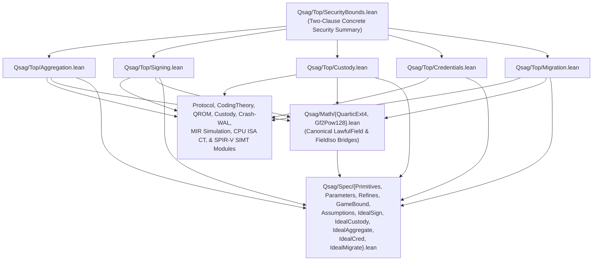

# QSAG Proof Architecture Guide

This document provides an auditor-first guide to the `Qsag` Lean 4.35 formal verification hierarchy. Following the design discipline of `seL4` (abstract state-machine refinement), `CompCert` (simulation composition), `CryptHOL` / `SSProve` (state-separating game reductions), and `Fiat-Crypto` (canonical algebraic interfaces), the proof hierarchy separates the **specification trust boundary** (`Qsag/Spec/`), **canonical algebraic bridges** (`Qsag/Math/`), **mechanism and machine proofs**, and **end-to-end composed subsystem theorems** (`Qsag/Top/`).

---

## 1. Five-Minute Auditor Entry Map

An external reviewer auditing the formal claims of `Qsag` needs to inspect only **Layer 0 (`Qsag/Spec/`)** to understand *what* is proved and **Layer 4 (`Qsag/Top/`)** to inspect the *composed end-to-end theorem statements*, before letting the Lean 4 kernel and `audit-axioms` verify *how* every proof is discharged:

1. **Specification Trust Boundary (`lean/Qsag/Spec/`):**
   - Zero `import all` statements, zero custom `axiom`s, zero `sorry`, zero `native_decide` / `bv_decide`, and constructive `[propext, Quot.sound]` axiom footprint (`0 Classical.choice`).
   - Defines canonical rational bounds (`Spec.RatBound`), injective/framed binary codecs (`FixedCodec`, `FramedCodec`), state-machine trace refinement (`Machine`, `ForwardSim`, `LockstepSim`, `Refines`, `M₁ ⊑ M₂`), state-separating oracle games and query-bounded reductions (`Pkg`, `GameBound`, `Within`), explicit CryptHOL-style assumption records (`Spec.Assumptions`), and the five ideal subsystem functionalities (`IdealSign`, `IdealCustody`, `IdealAggregate`, `IdealCred`, `IdealMigrate`).
2. **Canonical Field & Polynomial Deduplication (`lean/Qsag/Math/`):**
   - Unifies duplicate extension-field representations across algebraic coding theory, succinct aggregation, SIMD carryless multiplication, and active MPC via explicit constructive `FieldIso` ring/field isomorphisms (`Math.QuarticExt4`, `Math.Gf2Pow128`).
3. **End-to-End Subsystem Entrypoints (`lean/Qsag/Top/`):**
   - Six zero-`import all` composition modules (`Top.Signing`, `Top.Custody`, `Top.Aggregation`, `Top.Credentials`, `Top.Migration`, and `Top.SecurityBounds`) chaining coding-theory, QROM, sponge/SPN, threshold MPC, POSIX crash-WAL, Aeneas MIR, CPU ISA constant-time, and SPIR-V SIMT proofs into composed `Refines` and `GameBound` theorems.



---

## 2. Layer 0 — Specification Trust Boundary (`lean/Qsag/Spec/`)

Every module in `lean/Qsag/Spec/` enforces Lean 4.35 `LAW-M1` module encapsulation (`module`, `public section`, at most `12` `@[expose]` declarations, and zero `import all`):

| Module |Exported Specifications & Calculi | Key Theorems |
| :--- | :--- | :--- |
| `Spec/Primitives.lean` | `Digest256`, canonical exact non-negative `RatBound` (`num / den`, `0 < den`), `atLeastBits`, `strictlyMoreThanBits`, `exceedsBitBudget`, `FixedCodec`, `FramedCodec` | `RatBound.le_trans`, `add_le_add`, `mul_le_mul`, lossless bridges to `Qsag.RatBound`, `UcGames.ratLe`, and `ExactRat` (`clampExactRat_strictlyMoreThanBits_of_lt_twoNegPow`), `FramedCodec.pair_injective` |
| `Spec/Parameters.lean` | Deployed profiles for SLH-DSA, Jorts, Baggy, Compact-1122, Corduroy, WHIR/HEM (`nv = 24`, `powBits = 16`), ML-DSA-44/65/87, RLWE-1024, Dual-LPN, and migration curves | `whirCanonical24_rate_consistent`, `compact1122_fits_packet_budget`, `mlDsaSpec_positive_security_dims`, `migration438_soundness_margin` |
| `Spec/Refines.lean` | `Machine S I O`, `Machine.Reachable`, `Machine.AdmitsTrace`, `ForwardSim`, `LockstepSim`, `Refines` (`M₁ ⊑ M₂`), `NetworkRefines`, `LeakageContract` | Constructive `Refines.refl`, `Refines.trans` (via `PProd` relational composition, `0 Classical.choice`), `preserve_admitsTrace`, `ofPartyForwardSim`, bidirectional `InteractiveService` bridges (`ofInteractiveBisim`, `toInteractivePrefixEquivalent`, `toInteractiveCoupledAcceptBits`) |
| `Spec/GameBound.lean` | `Within q` query-counted oracle runner, `Pkg` (`Pkg.link`, `Pkg.par`), finite coin-indexed `Exp`, `GameBound G₀ G₁ ε`, `ReductionWitness` | `adv_refl`, `adv_symm`, `adv_triangle`, `adv_hybrid`, `adv_until_bad` (fundamental lemma of game-playing), `event_le_reduction_win`, `event_le_two_reductions` |
| `Spec/Assumptions.lean` | Explicit assumption locales (`KeyedHashSecurityLocale`, `PublicPermutationLocale`, `CyclotomicRlweLocale`, `ExpandAccumulateDualLpnLocale`, `ModuleLatticeFips204Locale`, `PosixCrashFsyncContract`, `HardwareMicroarchContract`) | `FramedCodec.collisionOfDigestEq_sound` (constructive `PSum` branch between input equality and explicit `HashCollisionWitness`), `KeyedHashSecurityLocale.euf_total_error_bound` |
| `Spec/IdealSign.lean` | `IdealSignState` & `idealSignMachine` (stateless EUF-CMA, SUF-CMA, and stateful one-time leaf/epoch signing) | `idealSign_no_unlogged_forgery`, `idealSign_epoch_strict_monotonicity` |
| `Spec/IdealCustody.lean` | Unified `IdealCustodyState` & `idealCustodyMachine` (enrolled key invariant, quorum threshold gate, cumulative spend cap, durable latch replay/fresh authorization, sticky quarantine) | `idealCustody_complete_mediation_and_cap`, `idealCustody_quarantine_absorbs`, `idealCustody_latch_no_equivocation` |
| `Spec/IdealAggregate.lean` | `AggregateStatement`, `AggregateCommitteeRelation`, `idealAggregateMachine` | `idealAggregate_accepted_sound_and_quorum`, `AggregateCommitteeRelation.nodup_indices` |
| `Spec/IdealCred.lean` | `IdealCredState` & `idealCredMachine` (ML-DSA / BlindVC issuance, TOPRF determinism, BlindVC unlinkability) | `idealCred_no_unissued_presentation`, `idealCred_toprf_deterministic` |
| `Spec/IdealMigrate.lean` | `IdealMigrateState` & `idealMigrateMachine` (legacy-to-PQ claim registry and nullifier set) | `idealMigrate_nullifier_no_double_claim`, `idealMigrate_claimed_count_eq_nullifiers` |

---

## 3. Canonical Model Deduplication (`Spec/Primitives`, `Math/`, `Spec/Refines`)

Historically, parallel proof developments introduced multiple isomorphic representations of rationals, extension fields, binary fields, and custody state machines. Phase 1 unifies every family through proved lossless conversions and ring/field isomorphisms:

### 3.1 Three Rational Bound Models $\to$ `Qsag.Spec.RatBound`
- `ConcreteSecurityBudget.RatBound` $\leftrightarrow$ `Spec.RatBound` via `RatBound.toBudget` / `RatBound.ofBudget` (`ofBudget_le_iff`, `ofBudget_atLeastBits_iff`, `ofBudget_exceedsBitBudget_iff`).
- `UcGames.ratLe` (`Nat × Nat`) $\leftrightarrow$ `Spec.RatBound` via `RatBound.toUcPair` / `RatBound.ofUcPair` (`le_iff_ucRatLe`, `ucRatLe_iff_ofUcPair_le`).
- `GaussianHvzkAndDualLpn.ExactRat` (`Int / Nat`) $\leftrightarrow$ `Spec.RatBound` via `toExactRat`, `ofExactRatAbs`, and `clampExactRat` (`exactRat_nonneg_le_iff`, `clampExactRat_atLeastBits_of_le_twoNegPow`, `clampExactRat_strictlyMoreThanBits_of_lt_twoNegPow`).

### 3.2 Four Quartic Goldilocks $\mathbb{F}_{p^4}$ Models $\to$ `Qsag/Math/QuarticExt4.lean`
`Qsag.Math.QuarticExt4` defines canonical `Ext4` ($\mathbb{F}_p[X]/(X^4 - 7)$ where $p = 2^{64} - 2^{32} + 1$), equips all four representations (`Math.Ext4`, `Qsag.QuarticGoldilocks`, `Qsag.GoldilocksExt4`, and `Qsag.Aggregation.GoldilocksExt4`) with `CommRingOps` + `LawfulField`, and proves constructive `FieldIso` bijections preserving `zero`, `one`, `add`, `neg`, `sub`, `mul`, and `inv`:
- `isoExt4ToQuartic : FieldIso Ext4 Qsag.QuarticGoldilocks`
- `isoExt4ToBudget : FieldIso Ext4 Qsag.GoldilocksExt4`
- `isoExt4ToAgg : FieldIso Ext4 Qsag.Aggregation.GoldilocksExt4`
- `isoQuarticToAgg : FieldIso Qsag.QuarticGoldilocks Qsag.Aggregation.GoldilocksExt4`
- `FieldIso.transport_welch_berlekamp_unique`: Transports algebraic Reed–Solomon / Welch–Berlekamp proximity-gap uniqueness theorems directly across isomorphic field carriers.

### 3.3 Five Binary Field $\mathbb{F}_{2^{128}}$ Models $\to$ `Qsag/Math/Gf2Pow128.lean`
`Qsag.Math.Gf2Pow128` equips Wiedemann `Tower128` (`Gf2Pow128`) with a constructive `LawfulField` instance (proving `towerInv_zero` by structural recursion over tower height $k$ with zero `decide` blowup) and unifies all five $\mathbb{F}_{2^{128}}$ implementations across the codebase:
1. Wiedemann recursive tower `BinaryTower.towerMul 7` (`Gf2Pow128`),
2. GHASH/CLMUL polynomial basis `Tower128PolyBasisIso.polyGf128Mul` via `isoGf2Pow128ToPolyBasis` (`psiTower128ToPoly` / `polyToTower128`),
3. Migration polynomial-basis `MigrationExecution.rustGf128Mul` (`polyMul_eq_rustGf128Mul`),
4. Machine-code specification `McRefine.gf128FieldMul` (`polyMul_eq_mcRefineGf128FieldMul`), and
5. Hardware `PCLMULQDQ` / `PMULL` / `VPCLMULQDQ` 4-product carryless reduction (`clmul_x86_and_arm64_agree_with_tower_iso`).

### 3.4 Nine Custody & Interactive Service Shells $\to$ `Spec/Refines` + `Spec/IdealCustody`
`Spec/Refines.lean`, `Spec/IdealCustody.lean`, and `Top/Custody.lean` fold `PartyMachine` (`InteractiveUcEngine`, `MirSpecBridge`), `InteractiveService` (`ThresholdIdealService`, `ThresholdIdealDurableService`), `Custody.Deployment` (`SeparatedCustody*`, `CompleteMediationBoundary`), `RssProduction.release`, and `PosixCrashWal` into a single `Machine` / `Refines` (`⊑`) partial order with bidirectional `PrefixEquivalent` and observer-coupling theorems.

---

## 4. Layer 4 — End-to-End Composed Subsystem Theorems (`lean/Qsag/Top/`)

Every module in `lean/Qsag/Top/` contains zero `import all` directives and proves composed cross-layer theorems ensuring that every completed library module participates in a top-level theorem:

### 4.1 `Qsag/Top/Aggregation.lean`
- **`aggExt4_cwyz26_fold_and_point_reduction`**: Instantiates `[CWYZ26]` Johnson-regime sliced bivariate fold decomposition (`Cwyz26JohnsonCertificate`, `HemFoldDecompositionBridge`), affine explanation equivalence, degree-2 point-reduction soundness (`HemPointReductionSoundness`), and `verifyHemAffineWhir` zero-oracle acceptance bounds (`HemVerifierAcceptance`) directly on `Aggregation.GoldilocksExt4` (`Math.QuarticExt4`).
- **`deployed_hem_stage_budget_and_aggExt4_transport`**: Transports `Aggregation.GoldilocksExt4` domains via `isoQuarticToAgg.symm` into `Cwyz26DeployedStages` + `HemSlicedFoldBudget.sliced_stage_supported_budget`, proving `Spec.RatBound.atLeastBits 184` round-by-round soundness and `atLeastBits 128` Don–Fehr–Majenz QROM soundness up to $Q + 1 \le 2^{27}$.
- **`qrom_hem_opening_and_invalid_coordinate_chain`**: Composes measured batch Merkle opening extraction (`QromBatchMerkleExtraction`, `HemExtractedOpeningBridge`), Zhandry compressed Fourier-register support invariants (`QromFourierSupport`), and coherent Merkle Plancherel equivalence (`QromCoherentMerkleBridge`).
- **`aggregate_merge_and_simt_gpu_noninterference`**: Composes `Spec.IdealAggregate.mergeWitnessMaps_valid`, recursive shard `MergeTree` quorum weight soundness (`ComposedQsAgAndMergeSecurity`), and decoded SPIR-V binary word SIMT constant-time noninterference (`SpirvSimtGpuEquiv`).
- **`multifold_salted_qrom_and_committee_boundary_chain`**: Composes salted-Merkle QROM `HEM` `nv = 24` soundness up to $Q + 1 \le 2^{40}$ and DFMS database overflow bounds (`QromSaltedMerkleStateRestoration`), `HemSlicedFoldBudget.dfm184_budget_at_2pow27`, and `CompositionInstances.committee_trace_boundary`.

### 4.2 `Qsag/Top/Signing.lean`
- **`production_euf_cma_gameBound`**: Packages the standard-model tweakable-hash `EUF-CMA` reduction (`ProdCollisionEvents`, `ProdCollisionAccounting`, `ProdCollisionExtraction`) into an explicit `Spec.GameBound` (`εItsr + εTcr + εPre`) with `prodPathTargetCount` candidate-pool bounds.
- **`waistbandCache_refines_stateless` / `waistbandCache_preserves_multiturn_traces`**: Lifts deterministic `Jorts` waistband-cached signing (`SignatureOutputAndCacheLaws`) into `Spec.Refines`.
- **`sponge_and_spn_poly_basis_composition`**: Composes `pad10*1` sponge framing domain disjointness (`SpongeFramingAndDomainSep`), parallel seeded SPN polynomial-basis agreement (`ParallelSeededSpnPolyBasis`), and `CLMUL`/`PMULL` field agreement (`Math.Gf2Pow128`).
- **`isa_zeroize_and_ret_ct_composition`**: Composes Sewell–Myreen–Klein DAG loop translation validation for x86-64 `ct_memzero` (`SydTvTranslationValidation`) with public `rsp` stack-return constant-time noninterference (`ConstantTimeIsa`, `ElfFunctionalEquiv`, `FaultAndSpeculativeSafety`).
- **`adaptive_within_and_compact1122_signing_chain`**: Composes adaptive dual-oracle tree query budgets and `Corduroy` custody target-pool bounds (`ProdAdaptiveTcrReduction`), prefix-free `FrontierAntichain` FTS profiles (`AdvancedMpcAndCreds`, `HybridAddrPolicyAndFullPresetSecurity`, `BaggyAndRss256Security`), and production coin-toss query bounds (`ProductionCoinReduction`).
- **`public_spn_qrom_differential_walsh_and_isa_cosim`**: Composes public-SPN feed-forward chain steps and coherent QROM preimage bounds (`ParallelSeededPublicPermutation`, `ParallelSeededPublicPermutationGame`), salted preprocessing compression bounds (`QromPreprocessingGame`), committed-key differential & Walsh–Hadamard hull bounds (`SpnCommittedDifferential`, `SpnWalshHull`), and x86-64 strict ISA co-simulation (`IsaCosim`).

### 4.3 `Qsag/Top/Custody.lean`
- **`rssSharedRelease_refines_reference` / `rssSharedRelease_preserves_traces`**: Proves `rssSharedReleaseMachine p ⊑ rssReferenceReleaseMachine p` across arbitrary multi-turn schedules (`RssProductionProfile`).
- **`mirPolicy_refines_specPolicy` & `elf_to_idealTsig_refines` / `elf_to_idealTsig_trace_inclusion`**: Lifts the 4-layer `ELF → MIR → Protocol → IdealTsig` simulation stack (`MirSpecBridge`) into `Spec.Refines`.
- **`separated_custody_provenance_and_release_chain`**: Chains authenticated quorum submission (`SeparatedCustodyUcBridge`), coordinator/custodian spend caps (`CompleteMediationBoundary`), forgery/collision provenance (`SeparatedCustodyCollision`), non-hiding RSS release verification, and per-party quarantine share wiping.
- **`thresholdServiceShared_refines_ideal`, `thresholdDurableShared_refines_ideal`, & `threshold_durable_feedback_and_resource_burn_chain`**: Unifies `ThresholdIdealService`, `ThresholdIdealDurableService`, and `SeparatedCustodyUcResource` / `SeparatedCustodyResourceSoundness` under `Spec.Refines`, deriving `PrefixEquivalent`, coupled environment-observer acceptance equality, crash durability, and durable burn provenance.
- **`posix_wal_commit_and_anchor_rollback_fence`**: Composes POSIX `replaceAtomic` + external monotone anchor coherence (`PosixCrashWal`, `SeparatedCustodyUcBridge`) with whole-device rollback fail-closed recovery (`CeremonyAtomicityAndAbort`).
- **`rss_participant_network_gate_and_signing_execution_chain`**: Composes 3-party RSS network adversary isolation (`RssParticipantNetwork`), request-bound cSHAKE256 and cross-invocation abort (`RssParticipantBinding`), passive corrupt-party tape-bijection simulation (`RssParticipantPassiveSimulation`), degree-2 gate check soundness (`RssParticipantGateChecks`), enrolled signing program/wire refinement (`RssSigningEnrollment`, `RssSigningExecution`), and public WOTS leaf completion (`RssSigningPublicCompletion`).

### 4.4 `Qsag/Top/Credentials.lean`, `Qsag/Top/Migration.lean`, & `Qsag/Top/SecurityBounds.lean`
- **`Top/Credentials.lean`**: Proves `rlwe_preprocessing_and_dual_lpn_bias_chain` (`LatticePreprocessingFull`, `RlweExtractionBoundary`, `GaussianHvzkAndDualLpn` clamped to `Spec.RatBound.strictlyMoreThanBits 256`, `DensePcgProductionTaps`), `threshold_mldsa_and_toprf_chain` (`ThresholdMlDsaSecurity`, `ThresholdMlDsaAndToprf`), `blindVc_qrom_and_collision_finder_chain` (`BlindVcCollisionFinder`), and `idealCred_issuance_and_deterministic_toprf_chain` (`Spec.IdealCred`).
- **`Top/Migration.lean`**: Proves `migration_curves_zkboo_qrom_and_clmul_chain` (`PrattPrimalityCert`, `PallasAndBlsMigration`, `ActiveMigrationZeroTest`, `Math.Gf2Pow128`) and `idealMigrate_nullifier_uniqueness_and_count` (`Spec.IdealMigrate`).
- **`Top/SecurityBounds.lean`**: Proves the two-clause concrete security summary `qsag_unified_concrete_security_summary` (separating unconditional algebraic/statistical/simulation guarantees in Clause I from assumption- and oracle-conditional `Spec.RatBound.atLeastBits 128` portfolio guarantees in Clause II) paired with `securityBounds_sharp_query_ceiling_sensitivity` (`exceedsBitBudget 128` boundary witnesses).

---

## 5. Independent Verification Commands (Remote Linux Build Host)

All Lean 4.35 builds and axiom audits run on dedicated Linux verification hosts (`bb2` / `hbox`) under strict memory and timeout caps (`SWARM_MEM_MAX=16G`, `-DwarningAsError=true` / `--wfail`):

```bash
# 1. Compile Spec, Math, Top, and the full umbrella + axiom-audit binary with zero warnings:
SWARM_MEM_MAX=16G timeout --kill-after=10s 600s \
  lake build --wfail Qsag AuditAxioms

# 2. Verify that every exported theorem depends solely on {propext, Quot.sound}
#    (0 sorryAx, 0 Classical.choice, 0 Lean.ofReduceBool / trustCompiler):
./.lake/build/bin/audit-axioms

# 3. Verify constructive Lean policy, LAW-M1 encapsulation (<= 12 @[expose]),
#    and zero `import all` inside Qsag/Spec/* and Qsag/Top/*:
python3 ../scripts/check_lean_policy.py
```
