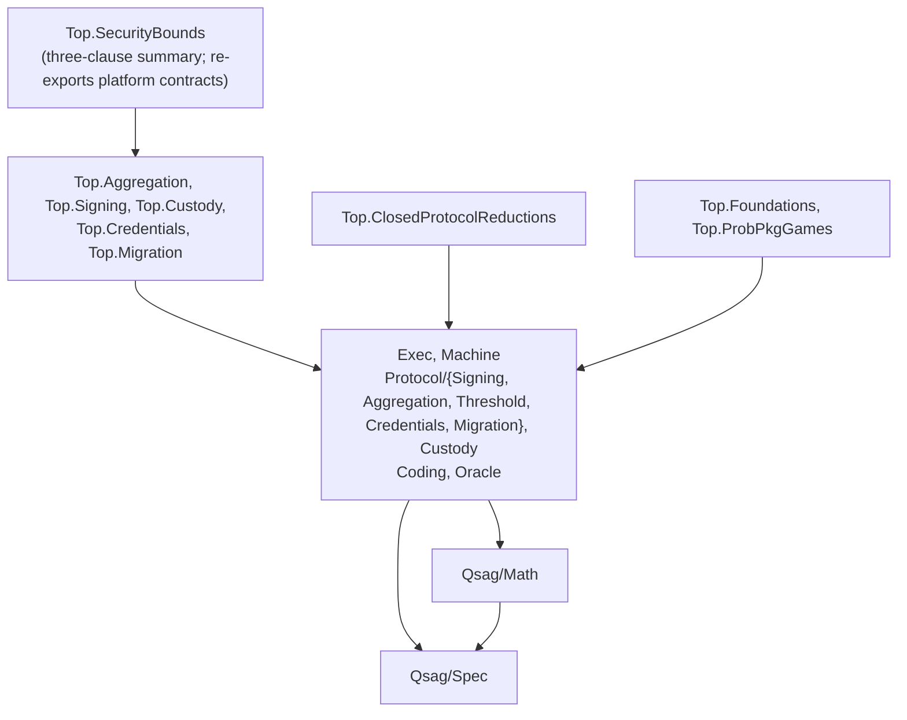

# QSAG Proof Architecture Guide

This document is an auditor-first guide to the `Qsag` Lean 4.35 library under `lean/Qsag/`. The library separates the **specification trust boundary** (`Qsag/Spec/`), **shared mathematics** (`Qsag/Math/`), **mechanism proofs by domain** (`Qsag/Coding/`, `Qsag/Oracle/`, `Qsag/Protocol/`, `Qsag/Custody/`, `Qsag/Exec/`, `Qsag/Machine/`), **composed subsystem statements** (`Qsag/Top/`), and **executed checks** (`Qsag/Tests/`). Section 2 is the directory map; every count in it was taken from the files on disk with the command printed there.

What a `Top/` theorem establishes is exactly its Lean statement. Several of them are conditional, or are equalities and arithmetic evaluations rather than security reductions; Section 6 says which, in the words of the modules themselves.

---

## 1. Five-Minute Auditor Entry Map

A reviewer reads **`Qsag/Spec/`** to learn *what* is specified and **`Qsag/Top/`** to read the composed statements, then lets the Lean kernel and the axiom audit check *how* each proof is discharged.

1. **Specification trust boundary (`lean/Qsag/Spec/`, 15 modules).**
   - No `import all`, no custom `axiom`, no `sorry`, no `native_decide` / `bv_decide`; the permitted axioms are `propext` and `Quot.sound` (no `Classical.choice`).
   - Defines rational bounds (`Qsag.RatBound` in `Spec/Bounds.lean`, `Qsag.Spec.RatBound` in `Spec/Primitives.lean`), injective and framed codecs (`FixedCodec`, `FramedCodec`), state machines and trace refinement (`Machine`, `Refines` written `M₁ ⊑ M₂`, `LockstepSim`, `DataRefines`, `ObsRefines`), packages and game bounds (`Pkg`, `Within`, `FinGame`, `GameBound`), hardness predicates and platform contracts (`Spec/Assumptions.lean`), and the five ideal machines (`idealSignMachine`, `idealCustodyMachine`, `idealAggregateMachine`, `idealCredMachine`, `idealMigrateMachine`).
2. **Shared mathematics (`lean/Qsag/Math/`).**
   - Start with `Math/QuinticExt5.lean` for challenge arithmetic, `Math/Poseidon2Gl24.lean` for the algebraic Canopy, and `Math/Gf2Pow128.lean` for binary-tower arithmetic. `Math/PolyRing.lean` defines the ring and field isomorphisms used for representation changes.
3. **Composed statements (`lean/Qsag/Top/`, 14 modules).**
   - The unified Lean 4.35 Cathedral contains 340 `Qsag` modules. The policy gate checks 432 source files across `lean/`, `aeneas/lean/` and `aeneas/lean-whir/`. The main audit records 139,005 declarations and 74,363 theorems. Together the three audits cover 148,052 declarations with 0 rejected.
   - The main comparator selects 152 `Qsag.Top` theorems. All 6/6 paranoid kernels accepted the 16,829 exported declarations in that replay. [Comparator roster](../lean/comparator.json)



---

## 2. Directory Map (`lean/Qsag/`)

Every library module lives in exactly one directory, and the module name follows the path
(`lean/Qsag/Custody/SeparatedCustody.lean` is `Qsag.Custody.SeparatedCustody`). Declaration
namespaces are independent of the path (for example `Qsag.Custody.payload_injective`,
`Qsag.QuinticGoldilocks`). No `.lean` file sits directly under `lean/Qsag/`.

Base names are unique except for three pairs, which must be cited with their directory:
`Aggregation.lean` (`Protocol/Aggregation/`, `Top/`), `Algebra.lean` (`Spec/`, `Math/`) and
`PlatformContractInstances.lean` (`Exec/`, `Machine/`).

| Directory | Modules | Lines | Selected contents |
| :--- | ---: | ---: | :--- |
| `Tactic/` | 4 | 2,366 | `AssuranceKit` (`#verify_constructive`, `#verify_inhabited`, `#tooth`, `#tooth_pair`), `AuditRegistry`, `CathedralKit`, `Prelude`. |
| `Spec/` | 15 | 18,949 | Specification trust boundary (Section 3). |
| `Math/` | 24 | 34,914 | `Algebra`, `PolyRing` (`RingIso` / `FieldIso`), `CoeffPoly`, `Counting`, `Goldilocks`, `GoldilocksBase`, `QuinticExt5`, `Poseidon2Gl24`, `Gf2Pow128`, `HasseHensel`, `Primality`, `EllipticCurves`, `Lattices`, `CyclotomicRlwe`, `MlDsaField`, `MlDsaNtt`, `CommitteeMasks`, `ConstructiveAmplitudeRing`, `TapRowParityBias`. |
| `Math/Tactic/` | 2 | 1,043 | `CommRing`, `MaskBijection`. |
| `Coding/` | 7 | 12,623 | `ReedSolomon`, `Resultant`, `GuruswamiSudan`, `AffineProximity`, `Cwyz26`, `WelchBerlekampDecoder`, `WhirProfiles`. |
| `Oracle/` | 18 | 36,102 | `Keccak`, `Poseidon2`, `Sponge`, `ByteFraming`, `Spn`, `FiatShamir`, `Qrom`, `SpecRatBridges`, `BlockCompressedOracle`, `PrefixMerkleExtraction`, `FrozenChallengeGame`, `ProbPkgBridge`, `ConstructiveQuantumHilbert`, `TwoWayQipmCompression`, `TwoWayQipmSwapAverage`. |
| `Protocol/Signing/` | 24 | 50,309 | `HashSigs`, `HypertreeEufCma`, `Fips205`, `SignatureOutputAndCacheLaws`, `FrontierCompact1122AndCorduroySecurity`, `HybridAddrPolicyAndFullPresetSecurity`, `PorsFpSecurity`, `PreprocessingSeedSeparation`, `ProdCollision`, `ProdHashReductions`, `FullAdaptiveEufCma`, `HulsingMultiHopReduction`, `ProductionJortsBaggyBounds`. |
| `Protocol/Aggregation/` | 38 | 86,452 | `PublicHemQuintic128`, `ZkHemV2PackedFiberCerts`, `ZkHemV2ComposedZkAndCerts`, `QuinticMultiStageWhir`, `SuccinctWhirExtractorAndIdealAggregate`, `ConcreteIvcWhir`, `MultiDepthRecursiveQromExtractor` (Section 6.3). |
| `Protocol/Threshold/` | 22 | 63,335 | `ThresholdMpc`, `Preprocessing`, `LatticePreprocessingFull`, `RlweExtraction`, `DensePcgTaps`, `MaliciousSecurity`, `MacBlind`, `SacrificeFreezeSample`, `Rss256TernaryRound`, `Rss256TwoPassProductProof`, `BaggyAndRss256Security`, `RssSlhFullSecurity`, `IdealTsig`, `ThresholdApproval`, `ThresholdMlDsaSecurity`, `ThresholdMlDsaAndToprf`, `MlDsa44Parameters`, `ProductionCoinReduction`, `ParametricThresholdAndUnlinkableQsa`. |
| `Protocol/Credentials/` | 6 | 14,785 | `AdvancedMpcAndCreds`, `BlindVcQromSecurity`, `BlindVcCollisionFinder`, `RepetitionCutAndChoose`, `ToprfMachine`. |
| `Protocol/Migration/` | 5 | 12,014 | `ActiveMigrationZeroTest`, `HdToprfAndMigrationSecurity`, `PallasAndBlsMigration`, `ZkHemV2Migration`, `ClosedIdealMigrateConnection`. |
| `Custody/` | 10 | 29,932 | `CustodySuiteFull`, `SeparatedCustody`, `JortsBeltLatchAndQuorumSwitching`, `ShamirThresholdCustodyRefinement`, `DistributedThresholdCustodyRefinement`, `MacaroonAttenuation`, `VolatileCoupon`. |
| `Exec/` | 46 | 41,254 | Execution models (Section 5): `SimulationSpine`, `RefinesBridges`, `GuardedMachineSim`, `InteractiveUcEngine` and the `Interactive*` contracts, `ThresholdIdealService`, `ThresholdIdealDurableService`, the `RssParticipant*` and `RssSigning*` machines, `RssProductionProfile`, `PosixCrashWal`, `TwoSlotHwmBase`, `TwoSlotHwmCrashModel`, `CeremonyAtomicityAndAbort`, `SeparatedCustodyResource`, `SeparatedCustodyUc`, `WhirKernels`, `SpecOracle`, and `PlatformContractInstances` (storage). |
| `Exec/Tactic/` | 1 | 964 | `SimulationKit`. |
| `Machine/` | 55 | 66,791 | Compiled code and extracted MIR: `ConstantTimeIsa`, the `X86*`, `Arm64*` and `Isa*` instruction models, `Elf64Headers`, `Elf64Parse`, `ElfParse`, `ElfBytes`, `ArParse`, `ElfVerify`, `ElfFixtures`, `ElfFixtureVerify`, `ElfInvCerts`, `ElfFunctionalEquiv`, `McRefine`, `McSymbols`, `SydTv`, `ClmulSimd`, `Gf128ClmulLoopAgreement`, `FaultAndSpeculativeSafety`, `IsaCosim`, `SpirvSimt`, `SpirvFixtures`, `MirSpecBridgeCore`, `MirSpecBridge`, `MirSpecBridgeWitnesses`, and `PlatformContractInstances` (SIMT and timing). |
| `Machine/Tactic/` | 1 | 29 | `KernelRfl`. |
| `Top/` | 14 | 17,170 | Composed statements (Section 6). |
| `Tests/` | 48 | 16,944 | Executed instances, `#eval` checks and mutation teeth (`*Teeth`, `*Checks`, `*Run`, `*Tests`, `CompositionInstances`, `GuardedMachineSimInstance`, `MathAndCoding`, `OracleAndQrom`, `EquationExports`). |
| **Total** | **340** | **505,976** | |

Reproduce the directory inventory from the repository root.

```bash
python3 - <<'EOF'
import os, collections
d = collections.defaultdict(lambda: [0, 0])
for dp, _, fn in os.walk('lean/Qsag'):
    for f in fn:
        if f.endswith('.lean'):
            k = os.path.relpath(dp, 'lean/Qsag')
            d[k][0] += 1
            d[k][1] += sum(1 for _ in open(os.path.join(dp, f), 'rb'))
for k in sorted(d): print(k, *d[k])
print(sum(v[0] for v in d.values()), sum(v[1] for v in d.values()))
EOF
```

The anti-strawman verifier gate in `scripts/check_lean_policy.py` rejects constant-true verifier definitions, including signature-scheme fields. Positive and negative controls exercise the source patterns.

**Layering.** `scripts/check_lean_policy.py` enforces a rank on the directories (`LAYER_RANK`):

```
Tactic(0) < Spec(1) < Math(2) < {Coding, Oracle}(3) < Protocol(4) < Custody(5) < Exec(6) < Machine(7) < Top(8) < Tests(9)
```

A module may import its own directory and any directory of strictly lower rank; `Coding` and
`Oracle` are peers and do not import each other. The same script requires every library module
to be reachable from `Qsag/Top/` and rejects `import all` anywhere inside `lean/Qsag/`
(`rg -l '^(public |private )?import all' lean/Qsag` prints nothing). `Tests/` is a sink: no
module outside `Tests/` imports one. `public meta import Lean` occurs only in the four `Tactic`
directories.

`lean/Qsag.lean` (the umbrella, 340 module imports) and `lean/AuditAxioms.lean` (the axiom gate) list
every module on disk. Both rosters are regenerated with `python3 lean/tools/gen_rosters.py`;
`scripts/check_lean_policy.py` and the `AuditAxioms` disk-inventory check reject an unregistered
file. Declaration totals are whatever the `AuditAxioms` gate and the `audit-axioms` executable
report on a fresh build (Section 7); both must report 0 rejected declarations.

---

## 3. Specification Trust Boundary (`lean/Qsag/Spec/`)

Every module in `lean/Qsag/Spec/` is a Lean 4.35 `module` with a `public section`, at most 12 `@[expose]` attributes and no `import all`.

| Module | Lines | What it defines | Representative theorems |
| :--- | ---: | :--- | :--- |
| `Spec/Algebra.lean` | 139 | `CommRingOps`, `LawfulCommRing` and the field classes used by every algebraic module. | (class definitions) |
| `Spec/Bounds.lean` | 353 | `Qsag.RatBound` (`num / den`, `0 < den`), `atLeastBits`, `strictlyMoreThanBits`, `exceedsBitBudget`, `QueryBudget`, `standardPq128Budget`. | `RatBound.le_trans`, `RatBound.add_le_add`, `RatBound.mul_le_mul`, `atLeastBits_add_union_loss`, `atLeastBits_sumList_union_loss`, `atLeastBits_scale_session_loss` |
| `Spec/Encoding.lean` | 509 | `encodeNatLeBytes`, `be` / `ofBE`, `FixedCodec`, `frameBytes` / `unframeBytes`, `concatFramed`, `domainFrame`, `taggedFixed`. | `FixedCodec.encode_injective`, `FixedCodec.prefix_injective`, `frameBytes_injective`, `prefix_free_injective`, `taggedFixed_ne_of_ne` |
| `Spec/Primitives.lean` | 396 | `Qsag.Spec.RatBound` with `atLeastBits`, `strictlyMoreThanBits`, `exceedsBitBudget`; `FramedCodec`; `DomainTag`; the conversions `RatBound.toBudget` / `RatBound.ofBudget` to `Qsag.RatBound`. | `RatBound.ofBudget_toBudget`, `RatBound.toBudget_ofBudget`, `RatBound.ofBudget_le_iff`, `RatBound.ofBudget_atLeastBits_iff`, `FramedCodec.encode_injective`, `DomainTag.disjoint` |
| `Spec/Parameters.lean` | 863 | Deployed parameter profiles: `pq128StatelessProfile`, `corduroyCustody128Profile`, `baggySha3_128fProfile`, `slhDsaShake128fProfile`, `pq128StatefulEpochProfile`, `pqCredentialProfile`, `densePcgV3Profile`, `CustodyQuorumProfile`. | `pq128StatelessProfile_wellFormed`, `pq128StatefulEpochProfile_wellFormed`, `pqCredentialProfile_soundness_params`, `pqCredentialProfile_rust_parity`, `CustodyQuorumProfile.honest_quorum_intersection` |
| `Spec/Refines.lean` | 506 | `Machine S I O`, `Machine.Reachable`, `Machine.AdmitsTrace`, `Refines` (`⊑`), `LockstepSim`, `ObsRefines`, `DataRefines` (interface-abstracting simulation through `projectTrace`), `PartyMachine`, `StepOutcome`, `ExecMode`, `LeakageContract`. | `Refines.refl`, `Refines.trans`, `Refines.preserve_admitsTrace`, `Refines.preserve_trace_safety`, `DataRefines.preserve_admitsTrace`, `DataRefines.reachable_rel` |
| `Spec/GameBound.lean` | 586 | `Iface`, `Code`, `Within` (query-counted code), `Pkg` (`Pkg.link`, `Pkg.par`), `FinGame`, `AdvDist`, `GameBound`. | `adv_refl`, `adv_symm`, `adv_triangle`, `adv_hybrid`, `adv_until_bad`, `event_le_reduction_win`, `event_le_two_reductions`, `event_le_three_reductions` |
| `Spec/Assumptions.lean` | 5,458 | Hardness predicates over explicit games (`SmDtTcrHard`, `SmDtPreHard`, `ItsrHard`, `PrfHard`, `DecisionRlweHard`, with `ModuleSisHard` and `RegularDualLpnHard`); `HashCollision`, `SecondPreimage`; platform contracts `PosixFsyncContract`, `AuthenticatedChannelContract`, `KeyErasureContract`, `DitHardwareContract`, `SimtWorkgroupContract` / `WellFormedSimtContract`. | `FramedCodec.collisionOfDigestEq_sound`, `SmDtTcrHard.mono`, `smDtTcrHard_constHash_refuted`, `prfHard_emptyOutput_refuted`, `moduleSisHard_noRows_refuted`, `hashSig_forger_bound` |
| `Spec/IdealSign.lean` | 2,180 | `SigScheme`, `IdealSignState`, `idealSignMachine`, `latchedSignerMachine`, `idealSignCorruptibleMachine`, `EufCmaForgery`, `SufCmaForgery`. | `idealSignMachine_reachable_inv`, `idealSignMachine_trace_epochs_increasing`, `idealSignMachine_failed_sign_burns_epoch`, `idealSignMachine_eufCmaForgery_iff`, `latchedSigner_trace_safe` |
| `Spec/IdealCustody.lean` | 1,567 | `CustodyIntent`, `CustodyApproval`, `CustodyLedger`, `custodyLedgerSign`, `IdealCustodyState`, `idealCustodyMachine`, `AsymmetricQuorumSystem`. | `idealCustody_reachable_safeInv`, `idealCustody_reachable_spend_accounting`, `idealCustody_reachable_release_honestly_approved`, `idealCustodyStep_wal_retry_and_conflict`, `abqs_belt_latch_unique_msg` |
| `Spec/IdealAggregate.lean` | 1,156 | `AggregateStatement`, `ValidAggregateWitness`, `mergeWitnessMaps`, `ValidBreak`, `TranscriptBreak`, `AggregateSoundnessOutcome`, `StraightLineExtractor`, `AggregateExtractorSound`, `idealAggregateMachine`. | `mergeWitnessMaps_valid`, `AggregateSoundnessOutcome.signer_trichotomy`, `AggregateExtractorSound.failure_bound`, `acceptAll_not_extractorSound`, `tooth_unsound_verifier_breaks_idealAggregate` |
| `Spec/IdealCred.lean` | 2,725 | `CredPort`, `CredCommand`, `IdealCredConfig`, `IdealCredState`, `credExec`, `idealCredMachine`. | `idealCredMachine_issuance_authenticated`, `idealCredMachine_presentation_sound`, `idealCredMachine_presentation_provenance`, `idealCredMachine_rejects_foreign_issue`, `idealCred_trace_corruption_monotone` |
| `Spec/IdealMigrate.lean` | 1,230 | `EnrolledSnapshot`, `MigrationClaim`, `LegacyOwnershipScheme`, `IdealMigrateState`, `idealMigrateMachine`. | `idealMigrateMachine_reachable_inv`, `idealMigrateMachine_trace_no_double_claim`, `idealMigrateMachine_trace_minted_le_enrolled`, `idealMigrateMachine_trace_nullifier_fresh` |
| `Spec/CorruptibleSignSimulation.lean` | 1,242 | Interactive simulation of a corruptible signer. | `Machine.simulate_validTrace_project`, `Refines.interact_eq` |
| `Spec/Sessions.lean` | 39 | `AbortReason`, `SessionOutcome`, `SessionScheduleReq`: wire data shared by the threshold-signing sessions. | (data only) |

The hardness predicates of `Spec/Assumptions.lean` are meaningful only for adversary classes
that exclude exhaustive search; the `*_refuted` theorems in that module show each predicate is
false for a degenerate primitive. Such counterexamples show sensitivity, not satisfiability; a separate inhabited instance is needed to rule out vacuous assumptions.

---

## 4. Canonical Models and the Bridges Between Them

The library contains several isomorphic representations of rationals, extension fields and binary fields, each introduced where it was most convenient. Each family is tied together by proved conversions.

### 4.1 Rational bound carriers

- `Qsag.RatBound` (`Spec/Bounds.lean`) $\leftrightarrow$ `Qsag.Spec.RatBound` (`Spec/Primitives.lean`) via `RatBound.toBudget` / `RatBound.ofBudget` (`RatBound.ofBudget_toBudget`, `RatBound.toBudget_ofBudget`, `RatBound.ofBudget_le_iff`, `RatBound.ofBudget_atLeastBits_iff`). The two carriers are isomorphic and both remain in use; `Top/SecurityBounds.lean` and `Top/ClosedProtocolReductions.lean` state their bounds through `Spec.RatBound.ofBudget`.
- `UcGames.ratLe` (`Nat × Nat`, `Protocol/Aggregation/UcGames.lean`) $\leftrightarrow$ `Spec.RatBound` in `Oracle/SpecRatBridges.lean` (`le_iff_ucRatLe`).
- `ExactRat` (`Math/Lattices.lean`) $\to$ `Spec.RatBound` via `clampExactRat` in `Oracle/SpecRatBridges.lean`.

### 4.2 Quintic Goldilocks $\mathbb{F}_{p^5}$

`Math/QuinticExt5.lean` defines the challenge field $\mathbb{F}_{p^5}=\mathbb{F}_p[X]/(X^5-3)$, where $p=2^{64}-2^{32}+1$. The five canonical wire limbs are coefficients in the power basis. `Math/Poseidon2Gl24.lean` defines the width-24 permutation and seven-limb Canopy digest. The digest ranges over $p^7$ values. The MIR welds connect the decoded coefficients and digest limbs to these Lean representations.

### 4.3 Binary field $\mathbb{F}_{2^{128}}$

`Math/Gf2Pow128.lean` defines the Wiedemann tower (`TowerElem`, `towerMul`), proves it a field, and relates it to the GHASH/CLMUL polynomial basis $\mathbb{F}_2[z]/(z^{128}+z^7+z^2+z+1)$ by `psiTower128ToPoly` / `polyToTower128` (`psiTower128ToPoly_field_isomorphism`, `ringIsoTower128ToPoly`). `Machine/Gf128ClmulLoopAgreement.lean` carries the same multiplication down to the Rust shift-and-reduce loop and the `PCLMULQDQ` / `VPCLMULQDQ` / `PMULL` reductions (`gf2_128_mul_bv_eq_rustGf128Mul`, `gf128FieldMul_eq_rustGf128Mul`).

### 4.4 Machines

`Spec/Refines.lean` is the single machine and refinement vocabulary. `Exec/RefinesBridges.lean` (Section 5.1) maps the older execution-layer shapes (`PartyMachine`, `ForwardSim`, `InteractiveService`) into it, so that the `Top/` statements about custody, signing and credentials are all `Spec.Refines` or `Spec.DataRefines` statements.

---

## 5. Simulation and Refinement Infrastructure

These modules add no security statement of their own. They are the proof kit the `Top/` refinements are built from.

### 5.1 `Exec/RefinesBridges.lean`

Morphisms between `Spec.Refines` and the execution layer:
- §1: `Qsag.PartyMachine` / `Qsag.ForwardSim` to and from `Spec.Machine` / `Spec.Refines`.
- §2: `NetworkRefines`, the horizontal `N`-party rushing-network product refinement.
- §3: bidirectional morphisms with `InteractiveService` (stateful feedback composition, `PrefixEquivalent`).
- §5: **`ErrSyncDataRefines`** and `IndexedSim`. `ErrSyncDataRefines C A visIn visOut` generalizes `Spec.DataRefines`: a rejected concrete step either *stutters* (`errVis c inp = none`, the abstract state stays) or *synchronizes* (`errVis c inp = some j`, the abstract machine also rejects `j` and moves to `A.errStep a j`). This keeps error-burned state, such as an epoch counter consumed by a failed signing attempt, in lockstep on both sides. Proved: `ErrSyncDataRefines.lift_validTrace`, `ErrSyncDataRefines.preserve_admitsTrace`, `ErrSyncDataRefines.reachable_rel`, `ErrSyncDataRefines.preserve_trace_safety`, the embeddings of `DataRefines` and `Refines` into it, `ErrSyncDataRefines.toRefines` for identical interfaces with every rejection synchronized, and `ErrSyncDataRefines.postcompose`. `Machine/MirSpecBridgeCore.lean` uses it for the belt-latch signer at the exact 64-epoch jump window.
- §6: `NetworkChannelSim`, the anti-replay authenticated transport combinator.

### 5.2 `Exec/GuardedMachineSim.lean`

The custody and signing guards of `Machine/MirSpecBridgeCore.lean` share one shape: a Boolean guard over `(state, input)`, a state update and output on success, a rejection otherwise. `GuardedMachine` states that shape once.
- `GuardedMachine.Models`: an existing `PartyMachine` computes a given guarded machine (`GuardedMachine.models_ofOutcome`, `GuardedMachine.models_ofOption`), with `trace_induction`, `trace_invariant` and `at_most_one_accept` for a latching guard.
- **`GuardedMachineSim`**: guard agreement, update and rejection preservation and output equality between two guarded machines; `toForwardSim`, `lift_trace`, `trace_safety`, and `GuardedMachine.forwardSimTo` for an abstract machine that is not guarded.
- Combinators, each with its simulation lifting:
  - **`GuardedMachine.zoom`** / `GuardedMachineSim.zoom`: run a guarded machine on a component of a larger state through a lawful `Lens` (`Lens.fst`, `Lens.snd`, `Lens.comp`); `GuardedMachine.zoom_frame_trace` is the frame property.
  - **`GuardedMachine.seq`** / `GuardedMachineSim.seq`: sequential composition on one state, feeding the first update and output to the second guard and preserving the first update if the second rejects (`GuardedMachine.seq_guard_true_iff`, `GuardedMachine.seq_trace_invariant`).
  - **`GuardedMachine.prod`** / `GuardedMachineSim.prod`: product of two guarded machines on a product state (`GuardedMachine.prod_fst_validTrace`, `GuardedMachine.prod_snd_validTrace`).
  - `GuardedMachine.comapIn`: reindexing of the input alphabet.
- `Tests/GuardedMachineSimInstance.lean` composes the four guard instances of `Machine/MirSpecBridgeCore.lean` (`mirVelocityGuard`, `mirBeltLatchKernelGuard`, `mirMlDsaReleaseGuard`, `mirRssCutGuard`) through `zoom`, `comapIn`, `prod` and `seq`.

### 5.3 `Exec/Tactic/SimulationKit.lean`

Proof automation in the `Qsag.Tactic.AssuranceKit` namespace:
- `by compose_forward_sim` / `by compose_refines`: goal-directed search chaining `ForwardSim.refl` / `ForwardSim.trans` / `LockstepSim.toForwardSim` and `Spec.Refines.refl` / `Spec.Refines.trans` / `Spec.LockstepSim.toRefines`.
- `by mir_sim_step`: a bounded structural splitter over `Option` and `Except`.
- `DataRefinement` with `Rel1`, `Rel2` and container relations, connecting `List UInt8`, `Nat`, `BitVec` and `Digest256` specifications to `ByteArray`, `UInt64`, `UInt32` and length-indexed byte slices.
- `LawfulFramedCodec`, `FramedField`, `framePair_inj`, `frameList_inj` and `by frame_prefix_inj` for multi-field byte-framing injectivity.

### 5.4 `aeneas/lean/QsagVerified/Proofs/MirWpKit.lean`

The corresponding kit on the extracted-MIR side, outside `lean/Qsag/`: `Result.wp` (total) and `Result.wlp` (fail-closed) weakest preconditions over the Aeneas `Result` monad; step rules `wp_ok`, `wp_fail_elim`, `wp_let`, `wp_ite`, `wp_mono`, `wlp_of_wp`; checked-arithmetic rules `wp_uscalar_add`, `wp_uscalar_sub`, `wp_uscalar_mul`; the relational combinators `MirRel1` / `MirRel2` (`MirRel1.comp_bind`); the tactics `mir_wp` and `mir_sim_step`; and one worked instance with its tooth (`mirCheckedDeltaCheck_wp_spec`, `tooth_mirCheckedDeltaCheck_exceeds_cap_fails`). See [AENEAS_VERIFICATION.md](AENEAS_VERIFICATION.md).

### 5.5 Platform contract instances

`Spec/Assumptions.lean` states the platform contracts abstractly. Two modules of the same base name instantiate them and are re-exported by `Top/SecurityBounds.lean`; no clause of the summary theorem there consumes a platform contract.

**`Exec/PlatformContractInstances.lean`, storage.** Builds the `FsyncStorageModel` induced by the three-tier `PosixFsState` machine of `Exec/PosixCrashWal.lean` and proves `walModel_contract : PosixFsyncContract (walModel ly)`, with `walModel_noRollback`, `walModel_anchorMonotone`, `walModel_anchorWitnessesDurable`, `walModel_commit_appends_to_visible_log` and `walModel_committed_survives`. `walModel_commit_not_exactly_one_record` shows why the contract allows pending records before the committed one: a rename that precedes a directory sync is flushed by the next directory sync.

**`Machine/PlatformContractInstances.lean`, SIMT and data-independent timing.**
- §1 `simtEpochContract`: the `SimtWorkgroupContract` of one barrier epoch of a SPIR-V kernel under the Wave32 semantics of `Machine/SpirvSimt.lean`, read off the observation trace. Well-formedness is checked for the two barrier epochs of the two-wave reduction kernel (`twoWaveReduction_epochs_wellFormed`, `twoWaveReduction_write_race_free`); the barrier-free concatenation is not well formed and is schedule dependent (`twoWaveNoBarrier_not_wellFormed`, `twoWaveNoBarrier_schedule_dependent`).
- §2 `faial_disjointStorageBindings`: an access protocol satisfying `FaialMapRaceFree` has disjoint storage bindings.
- §3 **`nttStageAddressModel`: an empty-trace boundary.** This is an address-formula model of one fused stage of `goldilocks_ntt.comp` (256 invocations, 8 Wave32 subgroups), *not* a contract derived from the shader. The Machine layer has no instruction stream for that shader, so `blockTrace` is `[]` for every invocation (uniform control flow holds trivially and says nothing about the shader) and the access sets are written by hand from `productionButterflyIndex` and `productionLdsIndex`; the read set is set equal to the write set by assumption. The one fact proved, `nttStageAddressModel_disjointStorageBindings`, is that those formulas assign no LDS cell to two invocations in each of the nine fused stages. That the shader accesses exactly these cells is not proved.
- §4 `armDitContract`, `x86DitContract`: `DitHardwareContract` instances whose observation is the leakage trace of `execArmProg` / `execX86Prog` on a checker-accepted kernel entry (`arm_kernel_sequence_leakage_data_independent`, `x86_kernel_sequence_leakage_data_independent`), with teeth `tooth_arm_umulh_leaks_without_dit_mode` and `tooth_x86_unrestricted_programs_have_no_dit_contract`.
- §5 **28 compiled `.rlib` symbol contracts.** `elfX86DitContract`, `elfArm64DitContract`, `rlibX86CtEntry` and `rlibArm64CtEntry` connect `Spec.DitHardwareContract` to the `qsag-asm` fixtures of `Machine/ElfVerify.lean` and `Machine/ElfFixtureVerify.lean`: the 19 `x86_64` symbols of `currentX86SymbolContracts` and the 9 `aarch64` symbols of `currentAarch64SymbolContracts`. Proved: `currentX86SymbolContracts_all_wf`, `currentAarch64SymbolContracts_all_wf`, `rlibX86CtEntry_binds_rlib_archive`, `rlibArm64CtEntry_binds_rlib_archive`, `rlib_x86_all19_dit_trace_data_independent`, `rlib_aarch64_all9_dit_trace_data_independent`, and the mutation teeth `tooth_rlib_x86_gfni_missing_vzeroupper_rejected` and `tooth_rlib_aarch64_pmull_missing_neon_wipe_rejected`. These are statements about the decoded fixture bytes under the modeled leakage semantics; see [CONSTANT_TIME_ASM.md](CONSTANT_TIME_ASM.md) for what that model does not cover.

---

## 6. Composed Statements (`lean/Qsag/Top/`)

No `Top/` module contains `import all`. Each subsection names the main declarations and states the limits the module's own header states.

### 6.1 `Top/Foundations.lean`

Instantiates results stated for an arbitrary field, answer width or amplitude ring at the deployed parameters.
- `goldilocks_welch_berlekamp_decoder`, `goldilocks_welch_berlekamp_eq_spec_decoder`: over Goldilocks the Welch–Berlekamp decoder is sound for every word, complete inside the unique-decoding radius, equal there to the specification list decoder, and costs at most $2(n+2)^3+5(n+2)^2$ field operations.
- `block256_fourier_database_support`: for 256-bit oracle answers, the Fourier database component with more than `t` nonzero blocks vanishes after `t` queries.
- `block256_prefix_merkle_extraction_bound`: at most $(d+Q_2+Q_1)(3Q_1+1)/2^{256}$ of oracles make an accepted Merkle opening differ from the one extracted from the Phase-1 log. This is a classical query bound.
- `weighted_compression_ideal_permutation_margin`: preimage and collision probabilities at most $2^{-128}$ for $Q \le 2^{56}$ two-way queries against a lazily sampled permutation of the $p^{12}$ states. The bound is about the lazily sampled permutation, not about `poseidon2Perm12`.
- `two_way_transposition_average_o2h`, `cliffordT_measure_reprogram_rbr_step` (amplitudes in $\mathbb{Q}(\sqrt2, i)$), `threshold_three_projection_mac_blind_bound`.

### 6.2 `Top/ProbPkgGames.lean`

The keyed random-oracle hiding game of `Oracle/Qrom.lean` as probabilistic packages (`Oracle/ProbPkgBridge.lean`): `keyedRomReal`, `keyedRomIdeal`, `keyedRom_hiding_advBoundedOn` (advantage at most `Q / cardB`), `keyedRom_hiding_multiSession` and `keyedRom_hiding_multiSession_gameBound` (`K · Q / cardB` over `K` independently keyed sessions), and the same for the hidden production coin share (`productionCoin_hiding_advBoundedOn`, `productionCoin_hiding_multiSession`, single-session bound $Q/2^{256}$).
*Limits:* `baseO` and `secretFn` are fixed functions; distinguishers are classical and deterministic; the factor `K` is from the hybrid argument and is not tight; replacing the oracle by concrete cSHAKE and relating the game to the signing transcript are not part of these statements.

### 6.3 `Top/Aggregation.lean`

| Layer | Constructive result |
| --- | --- |
| Public committee | `Protocol/Aggregation/PublicHemQuintic128.lean` proves `publicHemQuintic_qrom_soundness_128` for both Canopies, all 13 table sizes and $Q\le 2^{64}$. The budget includes separate commitment and Fiat–Shamir terms. |
| Committed-mask WHIR | `Protocol/Aggregation/ZkHemV2PackedFiberCerts.lean` proves the packed-fiber depth, single-OOD sampler and schedule bounds. `Protocol/Aggregation/ZkHemV2ComposedZkAndCerts.lean` treats the joint masked view, including the LogUp public refusal conditions. |
| Extraction into ideal aggregation | `Protocol/Aggregation/QuinticMultiStageWhir.lean` supplies the multistage fold geometry. `Protocol/Aggregation/SuccinctWhirExtractorAndIdealAggregate.lean` constructs the extractor and proves `succinctWhirAggregate_refines_idealAggregate_128`. Its failure bound uses the stated packed-slot game bounds, byte framing, decoder and separated coins at $16\le\log_2 N\le28$ and $Q\le2^{64}$. |
| Recursive composition | `Protocol/Aggregation/ConcreteIvcWhir.lean` checks the root opening. `Protocol/Aggregation/MultiDepthRecursiveQromExtractor.lean` gives straight-line inductive extraction and proves `multidepth_recursive_qrom_lt_2_neg_128` for the recursive margin schedule, $d\le16$ and $Q\le2^{64}$. `Top/Aggregation.lean` exports the inductive result, the numerical bound and depth-two acceptance and rejection witnesses. |

### 6.4 `Top/Signing.lean`

- The 4-hop full-adversary EUF-CMA reduction starts in `Protocol/Signing/FullAdaptiveEufCma.lean`, where the adversary can use the public key. `HulsingMultiHopReduction.lean` composes the message-PRF, secret-PRF, chain-simulation and primitive-break games. `ProductionJortsBaggyBounds.lean` evaluates the resulting budgets under the named primitive assumptions and query limits.
- **`production_euf_cma_gameBound`**: through `Spec.event_le_three_reductions`, the forger's winning probability is at most the sum of the probabilities of three extractor events on the same run (`ProdCollision`). It does not reduce those events to hardness experiments; `Top/ClosedProtocolReductions.lean` does that for the executable game.
- **`waistbandCache_refines_stateless`, `waistbandCache_preserves_multiturn_traces`**: the upper-hypertree cache (`SignatureOutputAndCacheLaws`) as a `Spec.Refines` witness.
- **`sponge_and_spn_poly_basis_composition`**: encoding separation of the `cSHAKE256` customization tags (`Oracle/Sponge.lean`) with polynomial-basis SPN chain evaluation (`Oracle/Spn.lean`, `Math/Gf2Pow128.lean`). The separation is a statement about absorbed block sequences, not a sponge or ideal-permutation security reduction.
- **`isa_zeroize_and_ret_ct_composition`, `isa_zeroize_ret_and_hardware_ct`**: translation validation of `ct_memzero` (`Machine/SydTv.lean`) with stack-return noninterference (`ConstantTimeIsa`, `ElfFunctionalEquiv`, `FaultAndSpeculativeSafety`).
- **`adaptive_within_and_compact1122_signing_chain`**, **`public_spn_qrom_differential_walsh_and_isa_cosim`**: query-budget, frontier-profile and SPN bound compositions (`ProdHashReductions`, `FrontierCompact1122AndCorduroySecurity`, `ProductionCoinReduction`, `IsaCosim`).
- **`productionSigScheme`, `productionLatchedSigner_refines_idealSign`, `productionLatchedSigner_trace_safe`**: the epoch-latched production signer refines `Spec.idealSignMachine`. Every emitted signature verifies under the derived public key, epochs are strictly increasing in stateful mode, and a failed signing consumes its epoch.
- Roster restatements: `hypertree_euf_cma_advantage_bound`, `production_euf_cma_advantage_bound`, the `threshold_sig_*` matched-input equalities, and the compiled-fixture results `currentX86_rlib_every_symbol_three_way_ni_sound`, `currentAarch64_rlib_every_symbol_three_way_ni_sound` and the `current_*_mc_refines` family.

### 6.5 `Top/Custody.lean`

- **`mirPolicy_refines_specPolicy`, `elf_to_idealTsig_refines`, `elf_to_idealTsig_trace_inclusion`**: `Spec.Refines.trans` composition of the `ELF → MIR → Protocol → IdealTsig` hierarchy (`MirSpecBridgeCore`, `MirSpecBridge`); `elf_to_idealCustody_dataRefines` and `elf_to_idealCustody_trace_inclusion` continue it through `fourLayerCustodyMachine`. The four-layer results assume quorum/corruption bounds, related initial states, `hSigMatch` (share signing equals assembled signing) and `hOracleEq` (assembled signing equals the ideal oracle). The layer-1 machine receives a signing callback; this is not a proof of a complete compiled signer.
- **`rssSharedReleaseMachine_eq_reference`, `thresholdServiceShared_eq_ideal`, `thresholdDurableShared_eq_ideal`: machine equalities.** Each pair has the same step function. `rssSharedRelease_preserves_traces` transports a trace along the equality. The former `*_refines_*` witnesses are no longer declared. These equalities alone say nothing about a distributed network; the separate distributed custody results below do.
- **`separated_custody_provenance_and_release_chain`**, **`threshold_durable_feedback_and_resource_burn_chain`**: authenticated quorum submission, spend caps, provenance and durable burn (`SeparatedCustody`, `SeparatedCustodyUc`, `SeparatedCustodyResource`, `ThresholdIdealDurableService`).
- **`posix_wal_commit_and_anchor_rollback_fence`, `posix_atomic_commit_and_two_slot_rollback_fence`, `posix_fsync_contract_wal_commit_and_anchor_fence`, `posixWalHost_wal_commit_and_anchor_fence`**: `replaceAtomic` with external monotone anchor coherence (`PosixCrashWal`, `TwoSlotHwmCrashModel`, `Exec/PlatformContractInstances.lean`) and fail-closed whole-device rollback (`CeremonyAtomicityAndAbort`).
- **`seqSessionChannel_contract`, `authenticated_channel_prevents_custody_replay`**: a sequence-numbered session channel satisfies `Spec.AuthenticatedChannelContract`.
- **`rss_participant_network_gate_and_signing_execution_chain`, `gate_batches_and_quorum_switching_disjointness`**: the `RssParticipant*` and `RssSigning*` execution chain and quorum-switching leaf disjointness (`JortsBeltLatchAndQuorumSwitching`).
- **`certCustodyMachine`, `certCustody_unsafe_release_le_forgery`, `macCustody_unsafe_release_le_key_guess`**: a certificate-pool coordinator with adaptive corruption; on traces without a forgery event it is simulated by `Spec.idealCustodyMachine`, and `Pr[unsafe release] ≤ Pr[forgery event]`.
- **`sepCustodyMachine`, `separatedCustody_refines_idealCustody_of`**: the real coordinator `Custody.submitRecorded` with production signing and adaptive corruption, related to `Spec.idealCustodyMachine` on runs satisfying the hypothesis `SeparatedCustodyRunAssumptions`. **`separatedCustody_dataRefines_idealCustody`** requires `SepDeploymentProfile` and refines the guarded restriction `sepCustodyGuardedMachine`, whose step checks the monotone leaf watermark, forgery-freedom (`sepForged = []`), and announced corrupted-party approvals. The concrete output is `.accepted r`; `sepGuardedVisOut` maps that acceptance to a signature supplied by the abstract `oracleSign` parameter. **`separatedCustody_forgery_wins_eufCma`, `separatedCustody_forgery_eufCma_gameBound`** turn a forgery event into an EUF-CMA win. This separated-custody result does not compose with the earlier machines; the conditional four-layer composition is the distinct `elf_to_idealCustody_dataRefines` result above.
- **`distributedCustody_refines_idealCustody`, `distributedCustody_trace_inclusion_and_safety`**: distributed `(t, n)` Shamir custody (`DistCustody.distMachine`: custodians, network buffer, adaptive corruption, coordinator ledger) refines `Spec.idealCustodyMachine` for its own `deploymentId` under `dep.WellFormed`; `shamirCustodian_refines_mediationVault`, `shamir_custody_network_non_equivocation`.
- **`authenticatedCustody_refines_idealCustody`, `authenticatedCustody_ideal_or_forgery`, `authenticatedCustody_unsafe_release_bound`**: under `AuthDeployment.WellFormed` (including share-commitment injectivity and codec round-trip), the guarded WAL/acknowledgement network refines the ideal machine; an unguarded trace either projects to it or exhibits an acknowledgement forgery, message-tag collision or hash collision. Unsafe-release probability is bounded by the sum of the acknowledgement- and WAL-violation probabilities, which remain hypotheses. The separate `distributedShareCustody_dataRefines_or_collision` result avoids global injectivity for its share-opening machine and returns a collision among observed preimages as the alternative to ideal trace inclusion.
- Roster restatements: BDOZ MAC soundness, the `ucSimulatorTsig_*` bounds, the `rss3_*` TOPRF facts, `uc_production_threshold_forgery_transfer`.

### 6.6 `Top/Credentials.lean`

- **`pcg_dual_lpn_bias_in_spec_ratBound`**, **`rlwe_preprocessing_and_sis_boundary_chain`**, **`threshold_mldsa_hvzk_sacrifice_and_prss_chain`**, **`threshold_mldsa_frozen_sacrifice_sign_step_soundness`**: lattice, dual-LPN and threshold ML-DSA bounds (`Math/Lattices.lean`, `DensePcgTaps`, `LatticePreprocessingFull`, `RlweExtraction`, `ThresholdMlDsaSecurity`, `ThresholdMlDsaAndToprf`, `SacrificeFreezeSample`).
- **`blindVc_cut_and_choose_gameBound`, `blindVc_concrete_fp5_qrom_opening_soundness`**: the `PiBlindVc` cut-and-choose count over the concrete quintic field and the QROM opening-round bound (`RepetitionCutAndChoose`, `BlindVcCollisionFinder`).
- **`CredentialImplementation`, `toprfCredentialImplementation`, `piToprfCredMachine_dataRefines_ideal`**: the refinement obligation against `Spec.idealCredMachine`, inhabited by `piToprfCredService` (`Protocol/Credentials/ToprfMachine.lean`) with the state abstraction `Rel c a := c.abs = a`. `toprfCredentialImplementation_non_identity_state` shows the abstraction is not the identity, and `piToprfCredService_reservoir_never_resets` that the SPDZ reservoir is monotone across accepted and rejected steps. The full `piToprfCredMachine` may install fresh reservoirs but refuses current or retired session identifiers (`piToprfCredMachine_reservoir_never_rewinds`). It computes MAC checks from the online transcript and a state-held key, while accepted outputs come from `cfg.oprf` (or its cached value); it does not model the SPDZ arithmetic, and this service models issuance through its oracle. The service is a Lean protocol machine, not extracted from or proved equal to Rust `voprf_spdz.rs`.
- **`unauthenticatedCredService_not_implementation`**: an unauthenticated service does not inhabit the obligation.
- **`credPort_authenticated_by_channel_contract`**, with `tooth_open_relay_spoofs_issuer_credPort`: ties `Spec.CredPort` caller labels to `Spec.AuthenticatedChannelContract`.

### 6.7 `Top/Migration.lean`

- `Protocol/Migration/ZkHemV2Migration.lean` models the committed-mask ownership and settlement relation. `Protocol/Migration/ClosedIdealMigrateConnection.lean` connects checked assignment projection to ideal settlement. Rust implements the single-party and collaborative proof paths with zk-Hem v2. The MPC-in-the-head cut-and-choose theorems in `Protocol/Migration/` and `Protocol/Credentials/` concern their respective mathematical games.

- **`dlogOwnershipScheme`, `dlogOwnership_accepted_claim_has_unique_scalar`, `tooth_dlogOwnership_rejects_destination_swap`**: a destination-bound discrete-log instance of `Spec.LegacyOwnershipScheme`.
- **`rawSettlementMachine`, `rawSettlement_dataRefines_idealMigrate`, `rawSettlement_trace_simulated`, `dlogSettlement_dataRefines_idealMigrate`**: the settlement registry over raw submissions refines `Spec.idealMigrateMachine` through `SettlementWire.decode`, given `SettlementCircuitSound`; `dlogSettlement_circuitSound` supplies it for the discrete-log scheme.

### 6.8 `Top/ClosedProtocolReductions.lean`

Statements in `Spec.GameBound` form, each one implication from an execution of the verifier to explicit reduction events.
- **`whir_exec_closed_qrom_soundness`**: for a statement outside the language and any `Q`-query Fiat–Shamir adversary, `Pr[execWhirVerify accepts] ≤ scheduleQromError sched Q + Pr[the collision finder outputs a Merkle-hash collision]`, given a `ClosedWhir.WhirScheduleCert` for the schedule. `whirCollisionReduction_validBreak` shows the finder's output is a collision of the byte hash; that both inputs are recorded prover queries (`Spec.TranscriptBreak`) is not stated.
- **`sampledQueryWhir_closed_qrom_soundness`, `sampledQueryWhir_nonvacuity`**: uses the constructed `sampledQueryCert` for a one-stage, four-point sampled-query schedule, with no fold, sumcheck or OOD round. Honest proofs are accepted; a false statement is accepted on one exhibited challenge and the query-round flip count is at most two out of four. Its `scheduleQromError` exceeds one, so this is a nonvacuity witness, not a numerical security result. `WhirScheduleCert` packages a Boolean round-by-round certificate plus a proof that its flip counts fit the schedule bounds.
- **`jorts_baggy_closed_euf_cma_keyed_target_bound`**: `Pr[ExecEufCmaGame wins] ≤ εI + prodPathTargetCount · εT + prodPreCandidateCount · εP`, where the three `ε` bound games played by explicit adversaries that receive the public key and the hash and signing oracles only; `jorts_baggy_closed_euf_cma_same_trace_classification` partitions the winning coins. `jorts_baggy_closed_euf_cma_prf_keygen_hop` and `jorts_baggy_closed_euf_cma_spec_assumptions_bound` connect the game to `Spec.PrfHard`, `Spec.ItsrHard`, `Spec.SmDtTcrHard` and `Spec.SmDtPreHard`; `concrete_exec_euf_cma_spec_assumptions_witness` inhabits those hypotheses at a concrete point with bound `6 / 256 < 1`, which shows they are satisfiable and nothing about deployed parameters.

### 6.9 `Top/SecurityBounds.lean`

**`qsag_unified_concrete_security_summary`** has three clauses:
- **Clause I:** the comparison tap-row parity bias lies strictly between $2^{-118}$ and $2^{-117}$; the arithmetic inequality $8(q+1)^2 \cdot 2^{438} \cdot 2^{128} \le 3^{438}$ holds for $q+1 \le 2^{56}$; and under `AuthDeployment.WellFormed`, every authenticated-custody trace is an ideal trace or exhibits an acknowledgement forgery, message-tag collision or hash collision. The disjunction assigns no probability to those alternatives.
- **Clause II:** the 12-entry portfolio and RLWE OR-sigma and HEM `nv = 24` bound formulas evaluate to at most $2^{-128}$ within the stated query ceilings. This clause has no hardness or oracle-model hypothesis and does not identify those formulas with a protocol advantage.
- **Clause III:** two conditional finite-game event bounds. If acknowledgement/WAL violation probabilities sum to at most $2^{-128}$, unsafe custody release has probability at most $2^{-128}$. If the three production signing extractor-event bounds sum to at most $2^{-128}$, so does `prodEufCmaWin` (with the stated one-time-query condition). These event bounds are hypotheses about the run, not discharged standard-model hardness experiments.

The closed EUF-CMA reduction to oracle-access adversaries, the Quintic schedule budgets and waistband-cache refinement are separate statements. No summary clause consumes a platform contract. **`securityBounds_sharp_query_ceiling_sensitivity`** rejects the linear state-restoration fallacy at $Q=2^{40}-1$ and the raw unsalted CDHZ partition bound at $Q=2^{39}$; these are specific failed bounds, not a generic claim that all ceilings are tight.

---

## 7. Independent Verification Commands

From the repository root, run the source gate locally and the build, audit and replay on the designated Linux build host.

```sh
python3 scripts/check_lean_policy.py
cd lean
lake build --wfail Qsag AuditAxioms audit-axioms
lake exe audit-axioms
lake comparator --paranoid
```
