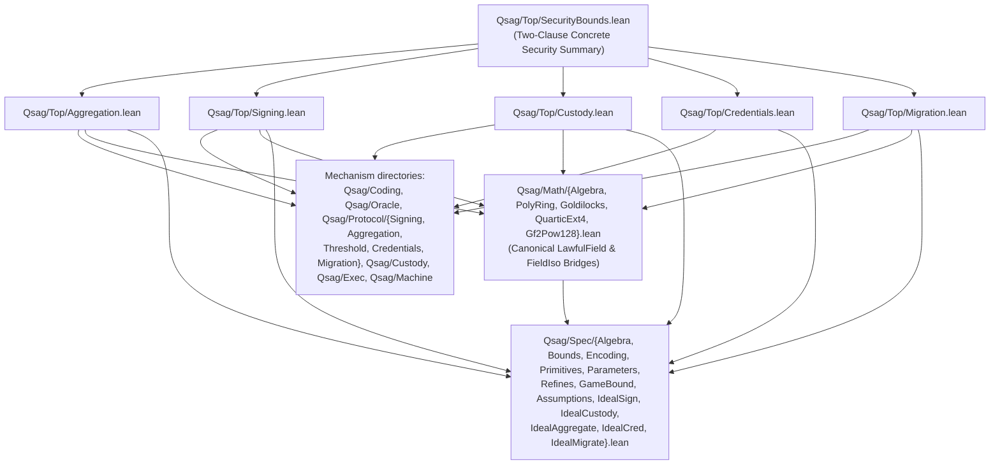

# QSAG Proof Architecture Guide

This document provides an auditor-first guide to the `Qsag` Lean 4.35 formal verification hierarchy. Following the design discipline of `seL4` (abstract state-machine refinement), `CompCert` (simulation composition), `CryptHOL` / `SSProve` (state-separating game reductions), and `Fiat-Crypto` (canonical algebraic interfaces), the proof hierarchy separates the **specification trust boundary** (`Qsag/Spec/`), **canonical algebraic bridges** (`Qsag/Math/`), **mechanism proofs by domain** (`Qsag/Coding/`, `Qsag/Oracle/`, `Qsag/Protocol/`, `Qsag/Custody/`, `Qsag/Exec/`, `Qsag/Machine/`), **end-to-end composed subsystem theorems** (`Qsag/Top/`), and **executed checks** (`Qsag/Tests/`). Section 2 is the directory map.

---

## 1. Five-Minute Auditor Entry Map

An external reviewer auditing the formal claims of `Qsag` needs to inspect only **Layer 0 (`Qsag/Spec/`)** to understand *what* is proved and **Layer 4 (`Qsag/Top/`)** to inspect the *composed end-to-end theorem statements*, before letting the Lean 4 kernel and `audit-axioms` verify *how* every proof is discharged:

1. **Specification Trust Boundary (`lean/Qsag/Spec/`):**
   - Zero `import all` statements, zero custom `axiom`s, zero `sorry`, zero `native_decide` / `bv_decide`, and constructive `[propext, Quot.sound]` axiom footprint (`0 Classical.choice`).
   - Defines canonical rational bounds (`Spec.RatBound`), injective/framed binary codecs (`FixedCodec`, `FramedCodec`), state-machine trace refinement (`Machine`, `ForwardSim`, `LockstepSim`, `Refines`, `M₁ ⊑ M₂`), state-separating oracle games and query-bounded reductions (`Pkg`, `GameBound`, `Within`), explicit CryptHOL-style assumption records (`Spec.Assumptions`), and the five ideal subsystem functionalities (`IdealSign`, `IdealCustody`, `IdealAggregate`, `IdealCred`, `IdealMigrate`).
2. **Canonical Field & Polynomial Deduplication (`lean/Qsag/Math/`):**
   - Unifies duplicate extension-field representations across algebraic coding theory, succinct aggregation, SIMD carryless multiplication, and active MPC via explicit constructive `RingIso` / `FieldIso` isomorphisms (`Math/PolyRing.lean`, `Math/QuarticExt4.lean`, `Math/Gf2Pow128.lean`, `Protocol/Aggregation/FieldTransport.lean`).
3. **End-to-End Subsystem Entrypoints (`lean/Qsag/Top/`):**
   - Seven zero-`import all` composition modules (`Top.Signing`, `Top.Custody`, `Top.Aggregation`, `Top.Credentials`, `Top.Migration`, `Top.ClosedProtocolReductions`, and `Top.SecurityBounds`) plus the comparator theorem roster `Top.Apex` (the solution side of `QsagChallenge` / `comparator.json`), chaining coding-theory, QROM, sponge/SPN, threshold MPC, POSIX crash-WAL, Aeneas MIR, CPU ISA constant-time, and SPIR-V SIMT proofs into composed `Refines` and `GameBound` theorems.



---

## 2. Directory Map (`lean/Qsag/`)

Every library module lives in exactly one domain directory. Module names follow the path
(`lean/Qsag/Custody/SeparatedCustodyCore.lean` is `Qsag.Custody.SeparatedCustodyCore`); declaration
namespaces are independent of the path and were not changed by the move (for example
`Qsag.Custody.payload_injective`, `Qsag.Aggregation.GoldilocksExt4`). File base names are unique
across the library, so `find lean/Qsag -name '<Base>.lean'` locates any module cited by base name.

| Directory | Modules | Lines | Contents |
| :--- | ---: | ---: | :--- |
| `Tactic/` | 2 | 1,366 | `AssuranceKit` (`#verify_constructive`, `#verify_inhabited`, `#tooth`, `#tooth_pair`) and `Prelude`. The only directory allowed `public meta import Lean`. |
| `Spec/` | 13 | 8,304 | Specification trust boundary (Section 3): algebra classes, bounds, codecs, refinement and game calculi, assumption records, the five ideal functionalities, deployed parameter profiles. |
| `Math/` | 13 | 21,143 | `Algebra`, `PolyRing` (including `RingIso` / `FieldIso`), `CoeffPoly`, `Counting`, `Goldilocks`, `QuarticExt4`, `Gf2Pow128` (Wiedemann tower and polynomial-basis isomorphism), `HasseHensel`, `Primality`, `EllipticCurves`, `Lattices`, and the `Math/Tactic` ring and mask-bijection tactics (Section 4). |
| `Coding/` | 5 | 9,927 | Reed–Solomon proximity gaps: `ReedSolomon`, `Resultant`, `GuruswamiSudan`, `AffineProximity`, and `Cwyz26` (the `[CWYZ26]` development: persistent and non-persistent incidence bounds, the fold-decomposition bridge, deployed stage tables). |
| `Oracle/` | 7 | 18,513 | Hash primitives and oracle models: `Keccak`, `Poseidon2`, `Sponge` (framing and domain separation), `Spn` (permutation and trail analysis), `FiatShamir`, `Qrom` (measured, coherent and Fourier-register extraction), `SpecRatBridges`. |
| `Protocol/Signing/` | 15 | 24,558 | Hash-based signatures: `HashSigs`, `HypertreeEufCma`, `Fips205`, output and cache laws, `Compact1122`/`Corduroy`, address policy, the closed EUF-CMA game, and the `Prod*` production forgery-to-hash reductions. |
| `Protocol/Aggregation/` | 24 | 53,315 | `Aggregation`, `SuccinctAggregationIop`, AIR completeness, the `Hem*` WHIR soundness chain, `Cwyz26JohnsonCertificate` and `HemSlicedFoldBudget`, `ConcreteSecurityBudget`, `MultiRoundFsQrom`, salted-Merkle QROM state restoration, recursive Poseidon2 WHIR, `FieldTransport`, `UcGames`, merge and composition instances. |
| `Protocol/Threshold/` | 19 | 58,887 | Threshold MPC: `ThresholdMpc`, preprocessing (RLWE, dual-LPN, dense PCG), malicious security, RSS-256 product proofs, RSS SLH-DSA, `IdealTsig`, threshold ML-DSA and TOPRF, parametric `(t, n)` threshold. |
| `Protocol/Credentials/` | 3 | 7,088 | `AdvancedMpcAndCreds`, `BlindVcQromSecurity`, `BlindVcCollisionFinder`. |
| `Protocol/Migration/` | 3 | 8,832 | `ActiveMigrationZeroTest`, `HdToprfAndMigrationSecurity`, `PallasAndBlsMigration`. |
| `Custody/` | 17 | 22,938 | `CustodySuiteFull`, `CompleteMediationBoundary`, the `SeparatedCustody*` deployment, `JortsBeltLatchAndQuorumSwitching`, `ShamirThresholdCustodyRefinement`, and the ideal-service custody bridge. |
| `Exec/` | 40 | 38,555 | Execution models: `SimulationSpine`, `InteractiveUcEngine`, ideal services, the `RssParticipant*` and `RssSigning*` machines, `PosixCrashWal`, `CeremonyAtomicityAndAbort`, the `MirSpecBridge*` stack, `RefinesBridges`, `SpecOracle`. |
| `Machine/` | 15 | 51,120 | Compiled code: ELF parsing, binary verification and functional equivalence, `McRefine`, `ConstantTimeIsa`, `IsaCosim`, SIMD and SPIR-V equivalence, translation validation, fault and speculation boundaries, CLMUL loop agreement. |
| `Top/` | 8 | 4,479 | Composed subsystem theorems (Section 5), `ClosedProtocolReductions`, and `Apex`. |
| `Tests/` | 19 | 5,679 | Executed instances and `#eval` checks (`*Tests`, `*Checks`, `*Run`, `*Teeth`, and the per-domain `MathAndCoding` and `OracleAndQrom` collections). No module outside `Tests/` imports a `Tests/` module. |

Two modules, `VolatileCouponAndCapabilitySecurity` and `ZkHemSoundnessAndPrivacy`, currently sit
directly under `lean/Qsag/`.

The directories are domains, not strict layers. `Spec/` and `Top/` contain no `import all`
(`grep -rn '^import all' lean/Qsag/Spec lean/Qsag/Top` prints nothing), and `Tests/` is a sink.
Between the mechanism directories no directory-level acyclicity is claimed: a module imports
whatever states its result most directly.

`lean/Qsag.lean` (the umbrella) and `lean/AuditAxioms.lean` (the axiom gate) list every module on
disk, grouped by directory. Both rosters are regenerated with `python3 lean/tools/gen_rosters.py`;
`scripts/check_lean_policy.py` and the `AuditAxioms` disk-inventory check reject an unregistered file.

The table counts the 203 modules under the domain directories (205 with the two top-level
modules), 337,043 lines in all. Declaration totals are whatever the `AuditAxioms` gate and the
`audit-axioms` executable report on a fresh build of that tree (Section 6); both must report
0 rejected declarations.

---

## 3. Layer 0 — Specification Trust Boundary (`lean/Qsag/Spec/`)

Every module in `lean/Qsag/Spec/` enforces Lean 4.35 `LAW-M1` module encapsulation (`module`, `public section`, at most `12` `@[expose]` declarations, and zero `import all`):

| Module |Exported Specifications & Calculi | Key Theorems |
| :--- | :--- | :--- |
| `Spec/Primitives.lean` | `Digest256`, canonical exact non-negative `RatBound` (`num / den`, `0 < den`), `atLeastBits`, `strictlyMoreThanBits`, `exceedsBitBudget`, `FixedCodec`, `FramedCodec` | `RatBound.le_trans`, `add_le_add`, `mul_le_mul`, lossless bridges to `Qsag.RatBound`, `UcGames.ratLe`, and `ExactRat` (`clampExactRat_strictlyMoreThanBits_of_lt_twoNegPow`), `FramedCodec.pair_injective` |
| `Spec/Parameters.lean` | Production Rust-aligned profiles: stateless `Baggy-128f` & `Corduroy-128` (`32`B) + `SLH-DSA-128f` (`16`B), FORS-free `StatefulJortsProfile`, 4-stage `WHIR`/`HEM` (`B = [4,16,64,256]`, Johnson QROM `q = [258,130,88,66]`, CDHZ `[202,102,70,52]`), `PiBlindVc` (`N = 256`, `33` reps over `GF(p^5)`) + `ML-DSA-44`, and `DensePCG V3` + `RLWE-1024` | `pq128StatelessProfile_wellFormed`, `pq128StatefulEpochProfile_wellFormed`, `hemGoldilocksExt4Profile_basePrime_eq`, `pqCredentialProfile_soundness_params`, `CustodyQuorumProfile.honest_quorum_intersection` |
| `Spec/Refines.lean` | `Machine S I O`, `Machine.Reachable`, `Machine.AdmitsTrace`, `ForwardSim`, `LockstepSim`, `Refines` (`M₁ ⊑ M₂`), `NetworkRefines`, `LeakageContract` | Constructive `Refines.refl`, `Refines.trans` (via `PProd` relational composition, `0 Classical.choice`), `preserve_admitsTrace`, `ofPartyForwardSim`, bidirectional `InteractiveService` bridges (`ofInteractiveBisim`, `toInteractivePrefixEquivalent`, `toInteractiveCoupledAcceptBits`) |
| `Spec/GameBound.lean` | `Within q` query-counted oracle runner, `Pkg` (`Pkg.link`, `Pkg.par`), finite coin-indexed `Exp`, `GameBound G₀ G₁ ε`, `ReductionWitness` | `adv_refl`, `adv_symm`, `adv_triangle`, `adv_hybrid`, `adv_until_bad` (fundamental lemma of game-playing), `event_le_reduction_win`, `event_le_two_reductions` |
| `Spec/Assumptions.lean` | Explicit assumption locales (`HashSigAssumptions`, `RandomOracleContext`, `RlweAssumptions`, `DualLpnAssumptions`, `ModuleLatticeAssumptions`, `PosixCrashWalContract`, `ConstantTimeIsaContract`) | `FramedCodec.collisionOfDigestEq_sound` (constructive `PSum` branch between input equality and explicit `HashCollisionWitness`), `HashSigAssumptions.totalBound_zero_iff` |
| `Spec/IdealSign.lean` | `IdealSignState` & `idealSignMachine` (stateless EUF-CMA, SUF-CMA, and stateful one-time leaf/epoch signing) | `idealSignMachine_reachable_inv`, `idealSignMachine_stateful_monotonic` |
| `Spec/IdealCustody.lean` | Unified `IdealCustodyState` & `idealCustodyMachine` (enrolled key invariant, quorum threshold gate, cumulative spend cap, full historical-epoch WAL replay/conflict checking via `findReleasedEpoch`, sticky quarantine) | `idealCustodyMachine_reachable_inv`, `idealCustodyMachine_quarantine_absorbs`, `idealCustodyMachine_authorized_honest_witness`, `idealCustodyStep_wal_retry_and_conflict` |
| `Spec/IdealAggregate.lean` | `AggregateStatement`, `ValidAggregateWitnessMap`, `idealAggregateMachine` | `idealAggregateMachine_accept_sound`, `mergeWitnessMaps_valid` |
| `Spec/IdealCred.lean` | `IdealCredState` & `idealCredMachine` (accumulator-pinned, challenge-anti-replay `PiBlindVc` selective disclosure without plaintext witness leakage, and TOPRF evaluation) | `idealCredMachine_presentation_sound`, `idealCredMachine_selective_disclosure_privacy` |
| `Spec/IdealMigrate.lean` | `IdealMigrateState` & `idealMigrateMachine` (legacy-to-PQ claim registry, pool cap, and nullifier set) | `idealMigrateMachine_reachable_inv`, `idealMigrateMachine_rejects_duplicate_nullifier` |

---

## 4. Canonical Model Deduplication (`Spec/Primitives`, `Math/`, `Spec/Refines`)

The library contains several isomorphic representations of rationals, extension fields, binary fields, and custody state machines, each introduced where it was most convenient. Every family is tied to one canonical model through proved lossless conversions and ring or field isomorphisms:

### 4.1 Three Rational Bound Models $\to$ `Qsag.Spec.RatBound`
- `Qsag.RatBound` (`Protocol/Aggregation/ConcreteSecurityBudget.lean`) $\leftrightarrow$ `Spec.RatBound` via `RatBound.toBudget` / `RatBound.ofBudget` in `Spec/Primitives.lean` (`ofBudget_toBudget`, `toBudget_ofBudget`, `ofBudget_le_iff`).
- `UcGames.ratLe` (`Nat × Nat`) $\leftrightarrow$ `Spec.RatBound` in `Oracle/SpecRatBridges.lean` (`le_iff_ucRatLe`).
- `ExactRat` (`Int / Nat`, `Math/Lattices.lean`) $\leftrightarrow$ `Spec.RatBound` via `clampExactRat` in `Oracle/SpecRatBridges.lean`.

### 4.2 Quartic Goldilocks $\mathbb{F}_{p^4}$ models $\to$ `Qsag/Math/QuarticExt4.lean`
`Math/QuarticExt4.lean` defines `QuarticGoldilocks` ($\mathbb{F}_p[X]/(X^4 - 7)$, $p = 2^{64} - 2^{32} + 1$) with its field laws. `Protocol/Aggregation/FieldTransport.lean` relates it to the other carriers by explicit ring isomorphisms preserving `zero`, `one`, `add`, `neg`, `sub` and `mul`:
- `ringIsoQuarticToSuccinct : RingIso QuarticGoldilocks GoldilocksExt4`
- `ringIsoQuarticToAgg : RingIso QuarticGoldilocks Aggregation.GoldilocksExt4`
- `ringIsoQuarticToCertified`, onto the carrier of the Johnson certificate
- `RingIso.map_evalCoeffs`, `RingIso.map_nodup`, `RingIso.filter_roots_length`: polynomial evaluation, distinctness and root counts transport across an isomorphism, which is what carries the Reed–Solomon proximity statements from one carrier to another.

`RingIso`, `FieldIso`, `RingIso.symm`, `RingIso.trans` and `RingIso.toFieldIso` are defined once in `Math/PolyRing.lean`.

### 4.3 Binary field $\mathbb{F}_{2^{128}}$ models $\to$ `Qsag/Math/Gf2Pow128.lean`
`Math/Gf2Pow128.lean` defines the Wiedemann tower (`TowerElem`, `Tower128 = TowerElem 7`, `towerMul`), proves it a field (`towerInv_zero` by structural recursion over the tower height), and relates it to the GHASH/CLMUL polynomial basis $\mathbb{F}_2[z]/(z^{128}+z^7+z^2+z+1)$ by `psiTower128ToPoly` / `polyToTower128` (`psiTower128ToPoly_field_isomorphism`, `ringIsoTower128ToPoly`). `Machine/Gf128ClmulLoopAgreement.lean` carries the same multiplication down to the Rust shift-and-reduce loop and the `PCLMULQDQ` / `VPCLMULQDQ` / `PMULL` reductions (`gf2_128_mul_bv_eq_rustGf128Mul`, `gf128FieldMul_eq_rustGf128Mul`).

### 4.4 Nine Custody & Interactive Service Shells $\to$ `Spec/Refines` + `Spec/IdealCustody`
`Spec/Refines.lean`, `Spec/IdealCustody.lean`, and `Top/Custody.lean` fold `PartyMachine` (`InteractiveUcEngine`, `MirSpecBridge`), `InteractiveService` (`ThresholdIdealService`, `ThresholdIdealDurableService`), `Custody.Deployment` (`SeparatedCustody*`, `CompleteMediationBoundary`), `RssProduction.release`, and `PosixCrashWal` into a single `Machine` / `Refines` (`⊑`) partial order with bidirectional `PrefixEquivalent` and observer-coupling theorems.

---

## 5. Layer 4 — End-to-End Composed Subsystem Theorems (`lean/Qsag/Top/`)

Every module in `lean/Qsag/Top/` contains zero `import all` directives and proves composed cross-layer theorems ensuring that every completed library module participates in a top-level theorem:

### 5.1 `Qsag/Top/Aggregation.lean`
- **`aggExt4_cwyz26_fold_and_point_reduction`**: Instantiates `[CWYZ26]` Johnson-regime sliced bivariate fold decomposition (`Cwyz26JohnsonCertificate`, `Coding.Cwyz26`), affine explanation equivalence, degree-2 point-reduction soundness (`HemPointReductionSoundness`), and `verifyHemAffineWhir` zero-oracle acceptance bounds (`HemVerifierAcceptance`) directly on `Aggregation.GoldilocksExt4` (`Math.QuarticExt4`).
- **`deployed_hem_stage_budget_and_aggExt4_transport`**: Transports `Aggregation.GoldilocksExt4` domains via the quartic-field isomorphism of `FieldTransport` into the deployed stage tables of `Coding.Cwyz26` + `HemSlicedFoldBudget.sliced_stage_supported_budget`, proving `Spec.RatBound.atLeastBits 184` round-by-round soundness and `atLeastBits 128` Don–Fehr–Majenz QROM soundness up to $Q + 1 \le 2^{27}$.
- **`qrom_hem_opening_and_invalid_coordinate_chain`**: Composes measured batch Merkle opening extraction (`Oracle.Qrom`, `HemExtractedOpeningBridge`), Zhandry compressed Fourier-register support invariants (`Oracle.Qrom`), and coherent Merkle Plancherel equivalence (`QromCoherentMerkleBridge`).
- **`aggregate_merge_and_simt_gpu_noninterference`**: Composes `Spec.IdealAggregate.mergeWitnessMaps_valid`, recursive shard `MergeTree` quorum weight soundness (`ComposedQsAgAndMergeSecurity`), and decoded SPIR-V binary word SIMT constant-time noninterference (`SpirvSimtGpuEquiv`).
- **`multifold_salted_qrom_and_committee_boundary_chain`**: Composes multifold `[CWYZ26]` stage budgets (`Cwyz26EqualDegreeAndMultiFold.sliced_multifold_stage_supported_budget`), salted-Merkle QROM `HEM` `nv = 24` soundness up to $Q + 1 \le 2^{40}$ and DFMS database overflow bounds (`QromSaltedMerkleStateRestoration`), `HemSlicedFoldBudget.dfm184_budget_at_2pow27`, and deployed `xmssPoseidon2Geom` / `corduroyPoseidon2Geom` (`geom.wellFormed = true`) opening-batch quorum reductions (`CompositionInstances.boundary_of_hem_opening_batch`, `Composed.merged_quorum_reduction`) with a non-vacuous failure fragment.

### 5.2 `Qsag/Top/Signing.lean`
- **`production_euf_cma_gameBound`**: Packages the standard-model tweakable-hash `EUF-CMA` reduction (`ProdCollisionEvents`, `ProdCollisionAccounting`, `ProdCollisionExtraction`) into an explicit `Spec.GameBound` (`εItsr + εTcr + εPre`) with `prodPathTargetCount` candidate-pool bounds (guarded on `params.statefulJorts = false` for FORS-equipped profiles).
- **`waistbandCache_refines_stateless` / `waistbandCache_preserves_multiturn_traces`**: Lifts deterministic `Jorts` waistband-cached signing (`SignatureOutputAndCacheLaws`) into `Spec.Refines`.
- **`sponge_and_spn_poly_basis_composition`**: Composes `pad10*1` sponge framing domain disjointness (`Oracle.Sponge`), parallel seeded SPN polynomial-basis agreement (`Oracle.Spn`), and `CLMUL`/`PMULL` field agreement (`Math.Gf2Pow128`).
- **`isa_zeroize_and_ret_ct_composition`**: Composes Sewell–Myreen–Klein DAG loop translation validation for x86-64 `ct_memzero` (`SydTvTranslationValidation`) with public `rsp` stack-return constant-time noninterference (`ConstantTimeIsa`, `ElfFunctionalEquiv`, `FaultAndSpeculativeSafety`).
- **`adaptive_within_and_compact1122_signing_chain`**: Composes adaptive dual-oracle tree query budgets and `Corduroy` custody target-pool bounds (`ProdAdaptiveTcrReduction`, `FrontierCompact1122AndCorduroySecurity`), prefix-free `FrontierAntichain` FTS profiles (`AdvancedMpcAndCreds`, `HybridAddrPolicyAndFullPresetSecurity`, `BaggyAndRss256Security`), and production coin-toss query bounds (`ProductionCoinReduction`).
- **`public_spn_qrom_differential_walsh_and_isa_cosim`**: Composes public-SPN feed-forward chain steps and coherent QROM preimage bounds (`Oracle.Spn`), salted preprocessing compression bounds (`Oracle.Qrom`), committed-key differential & Walsh–Hadamard hull bounds (`Oracle.Spn`), and x86-64 strict ISA co-simulation (`IsaCosim`).

### 5.3 `Qsag/Top/Custody.lean`
- **`rssSharedRelease_refines_reference` / `rssSharedRelease_preserves_traces`**: Proves `rssSharedReleaseMachine p ⊑ rssReferenceReleaseMachine p` across arbitrary multi-turn schedules (`RssProductionProfile`).
- **`mirPolicy_refines_specPolicy` & `elf_to_idealTsig_refines` / `elf_to_idealTsig_trace_inclusion`**: Lifts the 4-layer `ELF → MIR → Protocol → IdealTsig` simulation stack (`MirSpecBridge`) into `Spec.Refines`.
- **`separated_custody_provenance_and_release_chain`**: Chains authenticated quorum submission (`SeparatedCustodyUcBridge`), coordinator/custodian spend caps (`CompleteMediationBoundary`), forgery/collision provenance (`SeparatedCustodyCollision`), non-hiding RSS release verification, and per-party quarantine share wiping.
- **`thresholdServiceShared_refines_ideal`, `thresholdDurableShared_refines_ideal`, & `threshold_durable_feedback_and_resource_burn_chain`**: Unifies `ThresholdIdealService`, `ThresholdIdealDurableService`, and `SeparatedCustodyUcResource` / `SeparatedCustodyResourceSoundness` under `Spec.Refines`, deriving `PrefixEquivalent`, coupled environment-observer acceptance equality, crash durability, and durable burn provenance.
- **`posix_wal_commit_and_anchor_rollback_fence`**: Composes POSIX `replaceAtomic` + external monotone anchor coherence (`PosixCrashWal`, `SeparatedCustodyUcBridge`) with whole-device rollback fail-closed recovery (`CeremonyAtomicityAndAbort`).
- **`rss_participant_network_gate_and_signing_execution_chain` & `gate_batches_and_quorum_switching_disjointness`**: Composes 3-party RSS network adversary isolation (`RssParticipantNetwork`), request-bound cSHAKE256 and cross-invocation abort (`RssParticipantBinding`), passive corrupt-party tape-bijection simulation (`RssParticipantPassiveSimulation`, `RssParticipantFixedTape`), degree-2 gate check & grouped batch soundness (`RssParticipantGateChecks`, `RssParticipantGateWeights`, `RssParticipantGateEvidence`, `RssParticipantGateBatches`), enrolled signing program/wire refinement (`RssSigningEnrollment`, `RssSigningExecution`), public WOTS leaf completion (`RssSigningPublicCompletion`), and quorum-switching `Jorts` leaf disjointness (`JortsBeltLatchAndQuorumSwitching`).

### 5.4 `Qsag/Top/Credentials.lean`, `Qsag/Top/Migration.lean`, & `Qsag/Top/SecurityBounds.lean`
- **`Top/Credentials.lean`**: Proves `pcg_dual_lpn_bias_in_spec_ratBound` (the Gaussian HVZK and dual-LPN bounds of `Math.Lattices`, clamped to `Spec.RatBound.strictlyMoreThanBits 256`, `DensePcgProductionTaps`), `rlwe_preprocessing_and_sis_boundary_chain` (`LatticePreprocessingFull`, `RlweExtractionBoundary`), `threshold_mldsa_hvzk_sacrifice_and_prss_chain` (`ThresholdMlDsaSecurity`, `ThresholdMlDsaAndToprf`), and `blindVc_presentation_and_collision_extraction_chain` (`Spec.IdealCred`, `Spec.pqCredentialProfile`, `BlindVcCollisionFinder`).
- **`Top/Migration.lean`**: Proves `legacy_curve_primality_extraction_and_ideal_migration_chain` (`Spec.IdealMigrate`, the Pratt certificates of `Math.Primality` and `Math.EllipticCurves`, `PallasAndBlsMigration`) and `active_migration_ceremony_qrom_and_gf2pow128_chain` (`ActiveMigrationZeroTest`, `HdToprfAndMigrationSecurity`, `Math.Gf2Pow128`).
- **`Top/SecurityBounds.lean`**: Proves the two-clause concrete security summary `qsag_unified_concrete_security_summary` (separating unconditional algebraic/statistical/simulation guarantees in Clause I from assumption- and oracle-conditional `Spec.RatBound.atLeastBits 128` portfolio guarantees in Clause II) paired with `securityBounds_sharp_query_ceiling_sensitivity` (`exceedsBitBudget 128` boundary witnesses).

---

## 6. Independent Verification Commands

Run the Lean 4.35 build and the axiom audit from the `lean/` directory with warnings as errors
(`--wfail`). A cold build of the whole library takes well over ten minutes and several tens of
gigabytes of memory, so run it on a Linux host with a memory limit in place and one build per
tree at a time; Lake resumes from the modules already built if a build is interrupted.

```bash
# 1. Build every library module, the axiom gate, and the audit binary with zero warnings:
lake build --wfail Qsag AuditAxioms audit-axioms

# 2. Re-run the dependency census from the compiled .olean files: every declaration of every
#    Qsag module must depend only on {propext, Quot.sound}:
.lake/build/bin/audit-axioms

# 3. Source policy (from the repository root): forbidden tokens (sorry, axiom, native_decide,
#    bv_decide, Classical.choice, ...), LAW-M1 (<= 12 @[expose] per file), LAW-M2, docstring
#    citations, and roster completeness of Qsag.lean and AuditAxioms.lean:
python3 scripts/check_lean_policy.py
```
